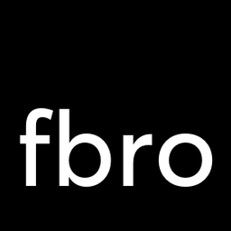

# fbro

<p align="center">
  
</p>

**fbro** is a dual-pane orthodox file manager for power users.

Built with [Tauri](https://tauri.app/) (Rust backend + React frontend). The backend owns state; the UI talks over WebSocket via intents and jobs.

> Status: early (`0.1.0`). Developed primarily on Linux; other platforms may work with gaps.

## Features

- Dual panels, tabs, F-key style operations, command palette
- Interruptible copy/move/delete with conflict handling and job queue
- Archives as folders (zip/7z), search results as a panel source
- **Bros** — processors for pack/extract, duplicates (Fedup), local↔remote integrity sync
- Git status and actions in the panel
- Embedded terminal + quick edit
- Viewer (text/hex/markdown/mermaid/media) and file compare
- Peer remote: pair two fbro instances, browse and transfer over SFTP

## macOS terminal word navigation with zsh

The embedded terminal sends `Esc b` for Option+Left and `Esc f` for
Option+Right. fbro inherits `EDITOR` and `VISUAL` from the process that starts
it. zsh starts with its vi insert keymap if either variable contains `vi`, and
otherwise starts with its emacs keymap. If you want Emacs bindings regardless
of those variables, enable **Use Emacs keys in new zsh terminal sessions** in
Settings → General. Close and reopen the embedded terminal to apply it.

If you prefer zsh's vi bindings, add these to `~/.zshrc` so both Option+Arrow
shortcuts move by words without leaving insert mode:

```zsh
bindkey -M viins '^[b' backward-word
bindkey -M viins '^[f' forward-word
```

Open a new terminal session after saving the file.

## Development

Requirements: [Node.js](https://nodejs.org/), [Rust](https://rustup.rs/), and [Tauri 2 system deps](https://v2.tauri.app/start/prerequisites/) for your OS.

```bash
npm install
npm run tauri dev
```

```bash
npm run tauri build
```

Smoke tests: see [TESTING.md](TESTING.md).

## Design docs

Architecture and protocol live under [`spex/`](spex/):

| Doc | Topic |
|-----|--------|
| [spec.md](spex/spec.md) | Overview |
| [proto.md](spex/proto.md) | FE ↔ BE protocol |
| [vfs.md](spex/vfs.md) | Virtual file system |
| [sources.md](spex/sources.md) | Source hierarchy, lifecycles, and tab mapping |
| [platform.md](spex/platform.md) | Platform abstraction layer |
| [keyboard.md](spex/keyboard.md) | Keyboard input ownership and priority |
| [modal-stack.md](spex/modal-stack.md) | Modal layering, focus, and restoration |
| [modal-keyboard-audit.md](spex/modal-keyboard-audit.md) | Modal keyboard audit findings |
| [settings.md](spex/settings.md) | Persistent settings |
| [tabs.md](spex/tabs.md) | Tabbed panels |
| [search.md](spex/search.md) | Search jobs and result sources |
| [bro.md](spex/bro.md) | Bro processors |
| [remote-fbro.md](spex/remote-fbro.md) | Peer remote |
| [thumbnails.md](spex/thumbnails.md) | Grid-view thumbnails |
| [virtual-panel.md](spex/virtual-panel.md) | Rendering huge directories |
| [inline-operations.md](spex/inline-operations.md) | Inline choices toolbar |

Contributor and agent conventions: [AGENTS.md](AGENTS.md).

## License

License TBD.
