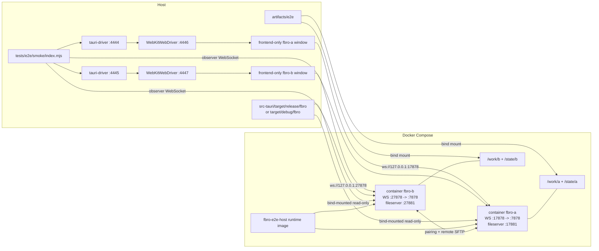

# Testing

HEIC2ANY preview checks: `cargo test --manifest-path src-tauri/Cargo.toml
heic_preview_is_opt_in` covers older settings defaulting to off and enabled
settings serialization. `tests/e2e/smoke/cases/heic.mjs` covers the settings
checkbox via keyboard, backend-confirmed state, modal focus restoration,
invalid HEIC error display, and disabling conversion in an open viewer.
The viewer check starts with the preference already enabled, covering its
lightweight startup settings patch. Set `FBRO_HEIC_FIXTURE` to a local HEIC
file to also check successful decoding in a freshly opened viewer, including
the newer `heic-to` fallback for files rejected by HEIC2ANY. Local headless
Edge checks decoded `IMG_0102.HEIC` (iPhone 16) at 3024 x 4032 and covered
buffered input, keyboard zoom, size limits, stale results, startup patches,
navigation to HEIF, and live toggles in both viewer modes.
Native Windows 10 and Linux WebView integration still need verification.

This project currently has a WebDriver smoke test for the Tauri app in
`tests/e2e/smoke/index.mjs`.

## Requirements

Install the normal project dependencies first:

```bash
npm install
```

The smoke test also requires:

- Docker with Compose support, accessible by the current user.
- `tauri-driver` in `PATH`.
- `WebKitWebDriver` in `PATH`.
- System runtime dependencies for building and running a Tauri/WebKitGTK app.
- `zip` for the archive scenario.

On Linux/Wayland, use the system `WebKitWebDriver` plus `tauri-driver`; the
local WebDriver-controlled app windows can be run with `GDK_BACKEND=wayland`.
The Dockerized backend app instances still run under `xvfb-run`.

## Smoke Tests

The local smoke flow checks the thumbnail queue's backend reply, Jobs modal
empty state, keyboard tab selection, focus preservation during refresh, and
focus restoration on close. `cargo test --manifest-path src-tauri/Cargo.toml
thumb_pool` covers deduplication, visibility priority and demotion, running
and completed tasks, concurrency limits, and bounded queue snapshots.
Thumbnail viewport smoke fixtures verify off-screen cards do not fetch,
expanded cards update their selection fill on keyboard selection/deselection,
off-screen requests stay queued during cooldown, and scrolling them into view
promotes and renders them immediately. Backend tests cover the exact 12-second
deadline, visibility demotion, unchanged viewport reports, completion resets,
automatic worker wakeup, explicit preview bypass, small and windowed listings,
inactive tabs, terminal surfaces, and stale listing epochs. Navigation smoke
checks queue clearing, release of abandoned requests, and rejection of late old
epoch requests. Backend tests cover preservation of another panel's work,
same-location rescans, cancellation tokens, return-to-location completion races,
and Linux read/seek cancellation without cache poisoning.
Native macOS and Windows thumbnail providers need platform-specific checks.

The local smoke flow covers symlink target hints, keyboard navigation into a
directory link, Up through a target child and back to the link's origin with
cursor restoration, history Back/Forward followed by Up, viewer navigation
through a file link, and errors for broken links. Backend return-route tests
also cover nested links, cross-source history, and archive round trips.
Rust tests cover link-preserving local file
operations and avoid traversing cyclic links during directory copies. Native macOS and Windows
symlink behavior still needs platform-specific verification.

Storage-policy regressions are covered by backend tests:

```bash
cargo test --manifest-path src-tauri/Cargo.toml storage
cargo test --manifest-path src-tauri/Cargo.toml viewer_prefetch
cargo test --manifest-path src-tauri/Cargo.toml thumb_pool
```

Linux fixtures cover internal NVMe/SATA, rotational disks, USB/MMC readers,
removable PCI devices, remote mounts, partitions, mapped/mixed devices, unresolved
members, hidden nested mounts, symlink targets, and device replacement. Instrumented
viewer and thumbnail tests verify rejected work does not call its provider and
foreground thumbnails still work. Windows storage-descriptor fixtures also run on
Linux, but do not exercise Win32 device queries. Tests inject registries only in test code;
there is no runtime eligibility override.

On native macOS and Windows, additionally verify source `storageClass` and
`prefetchEligible` on internal SSDs, external SSDs/card readers, network volumes,
and multi-device volumes. Unknown devices must stay disabled. Verify unplug/remount
updates within the discovery interval and does not reuse old viewer cache entries.
Linux fixture tests do not replace these native platform checks.

Removable-source eject requires a real-device check on native Linux with
UDisks2 and macOS: one-volume USB key, multi-volume USB drive, busy file job,
and a device held busy by another process. Confirm volume-only unmount leaves
sibling volumes mounted, whole-drive eject removes all sibling sources, and
open tabs recover to Home. The Docker smoke environment has no removable
device; it covers the picker, keyboard ownership, empty state, and focus return.

The smoke test starts two fbro backend/app instances named `fbro-a` and
`fbro-b`, starts two local `tauri-driver` processes, drives the UI through
WebDriver, and observes backend state over WebSocket.

Run the default smoke test:

```bash
npm run e2e:smoke
```

This uses `docker-compose.e2e.yml`. That image builds the app inside Docker,
which is reproducible but slower.

For faster local iteration, build the app once on the host and run the host
runtime image:

```bash
npm run tauri -- build --no-bundle
FBRO_E2E_COMPOSE_FILES=docker-compose.e2e.host.yml GDK_BACKEND=wayland npm run e2e:smoke:local
```

The host-runtime compose file builds only a runtime image and bind-mounts
`src-tauri/target/release/fbro` into both containers. Both `fbro-a` and
`fbro-b` use the same image.

For backend/debug iteration, build the debug binary and use the debug local
script:

```bash
GDK_BACKEND=wayland npm run e2e:smoke:local_debug
```

This uses `docker-compose.e2e.host.yml` plus `docker-compose.e2e.debug.yml`,
bind-mounts `src-tauri/target/debug/fbro` into both containers, and launches
the frontend-only app windows from the same debug binary. The script builds
that binary with `tauri build --debug --no-bundle` first; a plain `cargo build`
is not enough for this harness because it creates a dev-mode binary that tries
to load `http://localhost:5173`.

### Hybrid Host/Docker Layout

The local smoke mode is hybrid: WebDriver and the frontend-only app windows run
on the host, while the two backend-capable fbro instances run in Docker. The
host app windows connect to the Dockerized instances over WebSocket.



Useful environment variables:

- `FBRO_E2E_VIEWER_ONLY=1`: run only the image viewer regression flow. It covers
  delayed loads, more than 21 high-resolution JPEGs, reverse/rapid navigation,
  and recovery from an invalid image. HEIC/HEIF fixtures verify HTTP MIME types
  and hex fallback on Linux/Windows; on native macOS the same case checks image
  decoding via HTTP and buffered Blobs. The Docker harness runs Linux, so native
  macOS decoding still needs a separate check in both F3 and the embedded preview.
  Timings and process-memory samples are
  written to `artifacts/e2e/viewer-timings.json`; they include WebDriver and a
  local forwarding server's overhead and are not a standalone rendering benchmark.
- `FBRO_E2E_COMPOSE_FILES`: compose file list used by local smoke runs.
- `FBRO_APP_BINARY`: host app binary used by the frontend-only WebDriver
  windows. The debug script sets this to `src-tauri/target/debug/fbro`.
- `FBRO_E2E_ARTIFACTS`: artifact output directory. Defaults to `artifacts/e2e`.
- `FBRO_E2E_KEEP_DOCKER=1`: keep Docker containers after the run for debugging.
- `FBRO_A_WEBDRIVER_PORT`, `FBRO_B_WEBDRIVER_PORT`: tauri-driver HTTP ports.
- `FBRO_A_NATIVE_WEBDRIVER_PORT`, `FBRO_B_NATIVE_WEBDRIVER_PORT`: native
  WebKitWebDriver ports used under tauri-driver.

By default the smoke harness runs Docker cleanup in `finally`:

```bash
docker compose ... down --remove-orphans
```

Viewer diagnostics use the existing backend stderr log: `[viewer navigation]`
reports navigation preparation time, `[viewer http]` distinguishes cache hits
from disk reads, `[viewer prefetch]` reports scheduling/read/eviction activity
and allocated cache bytes, and `[thumbnail]` reports queue waits and generation
times. The prefetch cache is limited to 21 entries and 256 MiB, with two readers;
foreground loads do not wait for a prefetch slot.

Run the deterministic prefetch regression tests with:

```bash
cargo test --manifest-path src-tauri/Cargo.toml viewer_prefetch
```

## What The Smoke Test Covers

The smoke test exercises these flows:

- Local file operations on `fbro-a`:
  - Create directories and files.
  - Copy from left to right panel.
  - Rename and verify renamed content.
  - Delete and verify removal.
  - Sort entries by name, size, and date in both directions.
- Archive browsing: create a zip file, enter it from the UI, copy a file out of
  the archive, and verify extracted content.
- Search: search for `renamed.txt`, mount the search results source, and verify
  the result appears in the panel. Duplicate names have distinguishing path
  hints; the viewer displays each result's own content during forward and
  reverse j/k navigation. Backend tests also cover exact path/source resolution
  when search arrival order differs from panel order and results disappear.
- Datetime search: verify the Created/Modified time filter toggle works correctly.
  Creates a file with mtime set to two years ago and btime≈now, then searches
  with a "Between" interval covering current year ±1.  The modified filter must
  exclude the stale-mtime file (mtime outside the interval); the created filter
  must include it if the filesystem reports birth time.
- File size search: verify the size filter works for both "Bigger than" and
  "In range" operators.  Uses the sort-test files with known byte sizes: 500 B,
  100 B, and 10 B.  Asserts that only the correct file matches each filter and
  that all other files are excluded from results.
- Remote sharing: enable sharing on both instances, pair `fbro-b` to `fbro-a`,
  mount `fbro-a`'s shared `/work/a` source on `fbro-b`, verify the remote source
  is read-only, copy `remote.txt` from remote `fbro-a` into local `/work/b/dst`,
  and verify the copied payload.
- Local UI flows (`cases/local.mjs`, beyond the file operations above):
  - Colour scheme switch applies `data-color-scheme` on `.app`.
  - About modal from the command palette: sole top layer, one `role=dialog`
    with `aria-modal`, build-info formats, Escape restores panel focus.
  - Eject removable source command from the palette: picker is the top layer,
    initial focus is inside it, empty state disables eject, and Escape returns
    focus to the panel.
  - Bro help: Help in Pass to Bro opens Settings › Bros; closing returns focus
    to the Bro dialog's help button with its form values intact.
  - Bro list keyboard: opened from the command palette, the bro list gets
    initial focus; Tab / Shift+Tab move the selection like the arrow keys.
  - Copy Paths bro: launching it shows a "Copied … full path(s)" toast.
  - Modal default focus: Copy primary action (including existing destinations),
    Rename input, overwrite decision, Delete primary action (including reopen),
    completed-job Close, Search mask, active Settings tab, and pairing Cancel
    on both peers.
    Delete Tab reaches Background and Cancel; Enter on Cancel preserves the
    file and restores panel focus, while Enter on Delete removes it.
  - Copy/Rename dialogs: defaults, Tab reachability, keyboard Cancel, Copy `N`
    focusing/selecting the destination name without intercepting typed `n`, and copying
    to existing files with Ask and Overwrite (including an edited destination
    name); content checks verify replacement happens only after the Ask decision.
  - Contextual selection operations: inline toolbar and context-menu items for
    1/2/3 selected entries, cursor-row targeting, folder anchors.
  - Sort selector (Enter applies, Escape cancels, focus returns to the filter),
    quick-filter Escape restores the full listing, per-location sort on/off,
    Settings tab arrows and reset confirmation. Covered Settings/Bro layers
    are inert and hidden from accessibility; reset starts on Cancel and restores
    its trigger on Escape. Settings Tab skips inactive sidebar tabs.
  - Bookmark popover keyboard ownership, Up/Down selection without panel-cursor movement,
    Enter navigation, and a scroll height capped at half the owning panel.
  - Live date-sort cursor anchoring, inline image preview navigation, window
    focus restoration, grid-mode Left navigation.
- Git (`cases/git.mjs`, temporary repository):
  - Inline Git row toolbar: action order, arrow-key focus without moving the
    panel cursor, stage/unstage keep focus, rollback needs confirmation.
  - Git modal: Log tab expansion; Changes tab j/k/arrow navigation, Space and
    Ctrl+A selection, `s` stage toggle, Shift-click ranges, batch actions with
    two-step rollback.
  - Modal guards: global shortcuts are blocked while the Git modal is the top
    layer; an in-flight action disables its button and ignores repeat keys.
  - Journal entries for Git intents; Git metadata refreshes only on user action
    or navigation.
- Global selections (`cases/global-selection.mjs`): create from the context
  menu, persistence across reload, add entries via context menu and long
  right-click, focus follows existing/new selection mode, new-name Enter
  validates, Tab/Enter adds to the existing selection, and deleting inside a
  selection leaves the real files intact.
- Fedup (`cases/fedup.mjs`): launch from Pass to Bro on a global selection;
  default ignores, case-insensitive include patterns, custom excludes.
- Quick Edit (`cases/quick-edit.mjs`): edit in the embedded terminal, save,
  terminal closes; journal records intent/completed/failed.
- Viewer (`cases/viewer.mjs`): MP3 audio controls and Space play/pause dispatch
  (mocked playback; native codec/audio output needs a platform check), large-image loading overlay, j/k navigation
  under rapid keypresses, broken-image alert, prefetch eligibility per storage
  class, PDF rendering and window title, local Markdown and HTML image loading
  (including centered wrappers and explicit dimensions), Mermaid rendering, zoom and overlay
  Escape. Timings go to `viewer-timings.json`.
- Search modal keyboard (`cases/search.mjs`): roving tab focus, Enter on
  Close, global shortcuts blocked while Search is the top layer.

Native macOS and Windows modal focus and keyboard behavior still require
verification. Smoke coverage samples the default-focus archetypes; it does not
exercise every operation conflict and cancellation state.

## Artifacts

The smoke test does not currently emit a formal test report such as JUnit or
HTML. It writes diagnostics under `artifacts/e2e`:

- `final-tree.txt`: final filesystem tree for both instances.
- `fbro-a.log`, `fbro-b.log`: container app logs.
- `logs/tauri-driver-a.log`, `logs/tauri-driver-b.log`: local driver logs.
- `transcripts/fbro-a.json`, `transcripts/fbro-b.json`: WebSocket observer
  transcripts.
- `screenshots/fbro-a-failure.png`, `screenshots/fbro-b-failure.png`: failure
  screenshots when a browser session exists.

The authoritative pass/fail signal is the process exit code.
