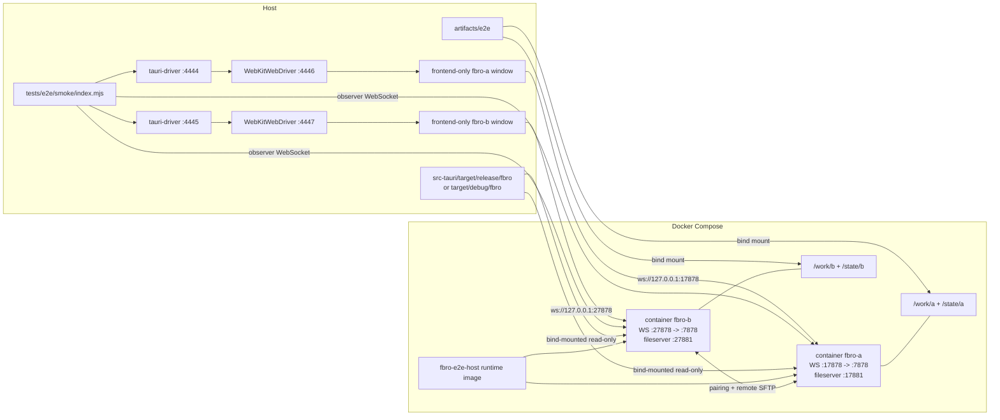

# Testing

This project currently has a WebDriver smoke test for the Tauri app in
`tests/e2e/smoke/index.mjs`.

## Requirements

Install the normal project dependencies first:

```bash
npm install
```

The smoke test also requires:

- Docker with Compose support, accessible by the current user.
- `tauri-driver` in `PATH`.
- `WebKitWebDriver` in `PATH`.
- System runtime dependencies for building and running a Tauri/WebKitGTK app.
- `zip` for the archive scenario.

On Linux/Wayland, use the system `WebKitWebDriver` plus `tauri-driver`; the
local WebDriver-controlled app windows can be run with `GDK_BACKEND=wayland`.
The Dockerized backend app instances still run under `xvfb-run`.

## Smoke Tests

The smoke test starts two fbro backend/app instances named `fbro-a` and
`fbro-b`, starts two local `tauri-driver` processes, drives the UI through
WebDriver, and observes backend state over WebSocket.

Run the default smoke test:

```bash
npm run e2e:smoke
```

This uses `docker-compose.e2e.yml`. That image builds the app inside Docker,
which is reproducible but slower.

For faster local iteration, build the app once on the host and run the host
runtime image:

```bash
npm run tauri -- build --no-bundle
FBRO_E2E_COMPOSE_FILES=docker-compose.e2e.host.yml GDK_BACKEND=wayland npm run e2e:smoke:local
```

The host-runtime compose file builds only a runtime image and bind-mounts
`src-tauri/target/release/fbro` into both containers. Both `fbro-a` and
`fbro-b` use the same image.

For backend/debug iteration, build the debug binary and use the debug local
script:

```bash
GDK_BACKEND=wayland npm run e2e:smoke:local_debug
```

This uses `docker-compose.e2e.host.yml` plus `docker-compose.e2e.debug.yml`,
bind-mounts `src-tauri/target/debug/fbro` into both containers, and launches
the frontend-only app windows from the same debug binary. The script builds
that binary with `tauri build --debug --no-bundle` first; a plain `cargo build`
is not enough for this harness because it creates a dev-mode binary that tries
to load `http://localhost:5173`.

### Hybrid Host/Docker Layout

The local smoke mode is hybrid: WebDriver and the frontend-only app windows run
on the host, while the two backend-capable fbro instances run in Docker. The
host app windows connect to the Dockerized instances over WebSocket.



Useful environment variables:

- `FBRO_E2E_COMPOSE_FILES`: compose file list used by local smoke runs.
- `FBRO_APP_BINARY`: host app binary used by the frontend-only WebDriver
  windows. The debug script sets this to `src-tauri/target/debug/fbro`.
- `FBRO_E2E_ARTIFACTS`: artifact output directory. Defaults to `artifacts/e2e`.
- `FBRO_E2E_KEEP_DOCKER=1`: keep Docker containers after the run for debugging.
- `FBRO_A_WEBDRIVER_PORT`, `FBRO_B_WEBDRIVER_PORT`: tauri-driver HTTP ports.
- `FBRO_A_NATIVE_WEBDRIVER_PORT`, `FBRO_B_NATIVE_WEBDRIVER_PORT`: native
  WebKitWebDriver ports used under tauri-driver.

By default the smoke harness runs Docker cleanup in `finally`:

```bash
docker compose ... down --remove-orphans
```

## What The Smoke Test Covers

The smoke test exercises these flows:

- Local file operations on `fbro-a`: create directories/files, copy from left to
  right panel, rename, delete, verify final file contents, and validate sorting
  by name/size/date.
- Archive browsing: create a zip file, enter it from the UI, copy a file out of
  the archive, and verify extracted content.
- Search: search for `renamed.txt`, mount the search results source, and verify
  the result appears in the panel.
- Remote sharing: enable sharing on both instances, pair `fbro-b` to `fbro-a`,
  mount `fbro-a`'s shared `/work/a` source on `fbro-b`, verify the remote source
  is read-only, copy `remote.txt` from remote `fbro-a` into local `/work/b/dst`,
  and verify the copied payload.

## Artifacts

The smoke test does not currently emit a formal test report such as JUnit or
HTML. It writes diagnostics under `artifacts/e2e`:

- `final-tree.txt`: final filesystem tree for both instances.
- `fbro-a.log`, `fbro-b.log`: container app logs.
- `logs/tauri-driver-a.log`, `logs/tauri-driver-b.log`: local driver logs.
- `transcripts/fbro-a.json`, `transcripts/fbro-b.json`: WebSocket observer
  transcripts.
- `screenshots/fbro-a-failure.png`, `screenshots/fbro-b-failure.png`: failure
  screenshots when a browser session exists.

The authoritative pass/fail signal is the process exit code.
