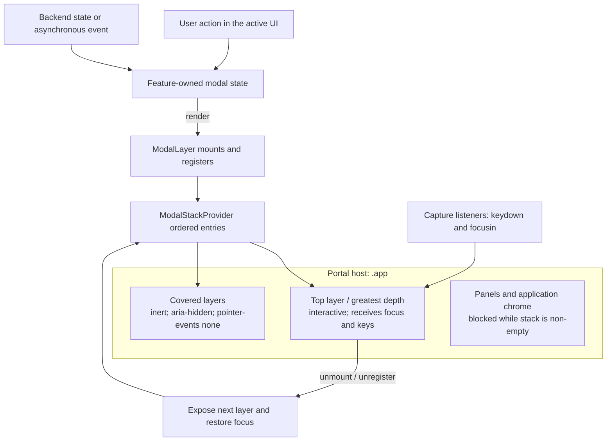

# Modal Stack

Full-screen dialogs share one frontend stack. The stack determines visual
depth, keyboard ownership, focus containment, and focus restoration; each
feature still owns the state that decides whether its dialog exists.

This is ephemeral UI state. It does not change backend authority, intent
semantics, or the WebSocket protocol.

---

## 1. Invariants

The Copy confirmation for multiple regular search-result files includes a native
Repeated filenames selector. `U` focuses it; its native keys select Exclude
duplicates or Add random suffix. The default resets to Exclude duplicates for
each confirmation. Choosing a policy leaves focus in the selector and does not
submit. Existing initial focus, Enter ownership, and opener restoration apply.

1. Every full-screen dialog is rendered through `ModalLayer`.
2. The most recently registered layer is the top layer.
3. Only the top layer is interactive and visible to assistive technology.
4. A key pressed while the stack is non-empty belongs to the top layer, never
   to a covered dialog or a panel.
5. Closing a layer restores the focus that existed immediately before it was
   opened, or focuses the newly exposed top layer when that target is gone.
6. Existing dialogs may remain visible below a translucent top layer, but are
   inert and cannot receive pointer, focus, or keyboard input.

---

## 2. Architecture

`ModalStackProvider` is mounted once above the application. A `ModalLayer`
portals its overlay into `.app` and appends a stable entry to the provider when
it mounts. Registration order is stack order; no central switch statement
needs to know every modal type.

Each layer exposes its position for diagnostics:

- `data-modal-id`: semantic dialog name
- `data-modal-depth`: zero-based stack position
- `data-modal-state`: `top` or `background`

The visual z-index is `100 + depth * 2`. A background layer is marked `inert`
and `aria-hidden`, and CSS disables its pointer events.

---

## 3. Push and Pop

### Push

When a feature renders a `ModalLayer`:

1. The layer captures the currently focused element as its restoration target.
2. It registers at the end of the ordered stack.
3. The previous top layer becomes a background layer.
4. Focus moves to `initialFocusRef`, an element marked
   `data-modal-initial-focus` or `autofocus`, the first focusable control, or
   finally the layer root. The layer entry keeps `initialFocusRef`, so every
   later refocus of the layer (after another layer pops without a usable
   restoration target, or when focus is redirected back into it) uses the same
   order. This matters when opening a dialog pops another layer in the same
   update, e.g. the command palette closing as the dialog it launched opens.

The visible dialog inside the layer is rendered through `ModalDialog` (or
`ResizableModal`, which composes it). This provides one `dialog` or
`alertdialog` role, an accessible label, and `aria-modal="true"` without
duplicating dialog semantics on the overlay.

User-triggered global commands that would open another modal are disabled
while the stack is non-empty. A modal may still explicitly open another modal,
and an asynchronous/backend-driven dialog may push above the current top.

### Pop

Unmounting a layer unregisters it. If it was the top layer, the next layer is
made interactive and focus is restored to the control that opened the removed
layer when possible.

A covered layer can disappear because its owning state changes. In that case,
the provider rewrites restoration references held by later layers. For example,
if focus moved `panel -> A -> B` and A disappears while B is open, closing B
restores focus to the panel rather than to a detached element from A.

If no modal remains and the opener is unavailable (detached, hidden, disabled,
or inert), restoration falls back to the active panel's listing or empty-folder
suggestion. A transient menu launching a dialog carries its original opener
through the transition, even when React removes the menu before the dialog
captures focus. Only removal of the top layer schedules a handoff; removing a
covered layer does not disturb the top layer's focused control. A newly opened
successor or deliberately focused outside control keeps ownership. Restoration
runs once after removal, rather than polling for lost focus. Feature dialogs
must not add competing panel-restoration callbacks.

The Open With picker retains the context menu's exact target identity. If a
listing change replaces the saved row with a different full path, even with
the same name and kind, the picker closes through the normal stack removal
and restores its opener. It never retargets a pending application launch.

---

## 4. Keyboard and Focus Ownership

The provider installs capture-phase `keydown` and `focusin` listeners while it
is mounted:

- `Tab` and `Shift+Tab` cycle through focusable controls in the top layer.
  Named radio groups contribute only their checked radio, or their first
  enabled radio when none is checked. Composite lists and tablists expose one
  sequential Tab stop and own their arrow-key navigation. A focused element
  inside `[data-modal-owns-tab]` receives `Tab` itself instead: the Pass to
  Bro list uses this so `Tab`/`Shift+Tab` move the selection like
  `ArrowDown`/`ArrowUp`. `Enter` and `Escape` remain the way out of such a list.
  The Git log exposes its active row followed by that row's enabled inline
  actions. Inactive commit/file rows, their buttons, and history Load more are
  excluded from the cycle. Tab leaves after the active row's last action;
  Shift+Tab reverses the order without entering another row. The existing
  Space shortcut retains keyboard access to history pagination.
- Focus attempting to leave the top layer is redirected into it.
- A key event whose target is outside the top layer is stopped and redispatched
  from the top layer. This covers browser timing cases where a focused button
  becomes disabled or is removed between key events.
- All other events already inside the top layer continue to that modal's own
  handler. Thus only the top modal interprets `Escape`, `Enter`, arrows, or
  feature-specific shortcuts.

Panels receive a `modalActive` guard derived from `hasActiveModal`. The toolbar
uses the same value to suppress global commands while a modal is present;
application zoom shortcuts remain available. Modal components must not install
independent window-level keyboard listeners.

---

## 5. Scope and Integration Rules

The stack covers full-screen overlays only. Context menus, input-history
dropdowns, bookmark popovers, inline pairing confirmations, and separate
viewer/diff windows are not modal layers. A pairing request opens the Sharing
settings modal; its confirmation is rendered in that settings surface rather
than as a second layer.

The removable-source picker uses one `ModalLayer` and `ModalDialog`; its
whole-drive warning is part of that dialog. The source-bar context menu is a
transient overlay and blocks panel and toolbar keys until it closes.

When adding or converting a full-screen dialog:

1. Wrap its overlay with `ModalLayer` and give it a stable semantic `modalId`.
2. Keep open/close and payload state with the owning feature.
3. Put keyboard handling on the layer or its descendants, not on `window`.
4. Declare the default focus with `initialFocusRef` or
   `data-modal-initial-focus`, according to §6. Never use a mount effect or
   timeout to focus the overlay after the stack has focused the control.
5. Do not add another global `isAnyModalOpen` expression; consume
   `useModalStack()` where an application-level guard is required.
6. Test that a second layer leaves the first visible but inert, that only the
   top layer handles keys, and that focus returns correctly after each pop.

Resizable dialogs retain their last pointer-selected size. Edge and corner
handles, including the visible south-east affordance, are a pointer
enhancement; keyboard access to dialog content does not depend on resizing.

The Jobs dialog has Jobs, Processes, Cache, and Notifications views, plus Thumbnails when the
backend reports `supportsManagedThumbnails`, in one roving tablist.
Left/Right and Home/End select and focus a visible view; Tab skips inactive
tabs. Thumbnail queue refreshes preserve focus, and Escape closes the dialog
without cancelling thumbnail generation.
The Notifications view has one focusable history list; Up/Down and Home/End
move its active entry without passing keys to covered panels. New entries keep
the browsed entry active. Clear history updates the backend and leaves queued
toast delivery intact. Toast arrival and expiry preserve modal focus.

The implementation lives in `src/components/ModalStack.tsx`; shared visual
rules live in `src/styles.css`.

## 6. Default Focus and Actions

Select Files and Deselect Files share the `selection-mask` layer and a compact
`ModalDialog`. They capture their originating panel, use shared mask input
history, and preselect the filename-extension default for overtyping. If the
cursor entry is outside the frontend's window, `RequestWindow` supplies the
prefill; its arrival never overwrites user edits or takes focus from another
control. Confirm is disabled until the listing and lookup are ready and the
mask is nonempty. Confirmation sends one selection intent and removes the layer;
selection changes only through backend patches. Escape closes history before
the dialog; focused Cancel retains native Enter activation. Panel removal or a
change of source/location removes the dialog through the same shared focus
restoration path. Covered layers remain inert; an open mask history dropdown is
suspended while covered, so it cannot intercept the top layer's Escape. It
returns with its owning layer and then closes before the mask dialog does.

Initial focus identifies the next useful keyboard action. It is independent
of button styling: a primary button does not automatically become the default.
Each dialog declares its target explicitly. Disabled or hidden targets are
ignored; the stack falls back to an enabled visible control, then the layer.
Controls with negative `tabIndex` can be explicit initial targets, but never
enter the sequential Tab cycle.

| Dialog or phase | Default focus | Enter from that target |
|---|---|---|
| Rename, Create Directory, New File | Name input | Submit once |
| Initialize Git repository | Initial branch input (defaults to main) | Submit once |
| Go To Path | Path input | Navigate once |
| Select Files / Deselect Files | Mask input; prefill selected | Submit once |
| Generic Input / Password | Value input | Submit once |
| Set Permissions | Apply | Apply permissions |
| To Global Selection | Existing-selection select, or new-name input | Native select behavior; new-name input submits once |
| Command Palette | Search input | Run the selected command |
| Open With | Application list | Launch the selected application |
| Pass To Bro | Bro list | Open parameters or launch the selected bro |
| Navigation History | History list | Navigate to the selected entry |
| About, Info, Jobs | Close | Close |
| No editor available | OK | Close |
| Git status/log | Close; first log item once a log-only repository's data is available | Close; log navigation owns row keys |
| Settings | Active sidebar tab | Native tab activation |
| Pairing within Settings | Cancel | Reject pairing |
| Reset remembered sorting | Cancel | Dismiss confirmation |
| Quit | Cancel | Dismiss confirmation |
| Eject source | Source select; Cancel when no source exists | Native select behavior; Cancel closes |
| Search: Input | File-mask input | Start an idle search once |
| Search: Extra | Extra tab | Native tab activation |
| Search: Results | To Results when available, otherwise Close | Mount results or close |
| Copy / Move / Extract / Delete confirmation | Main operation button | Start the operation once |
| Copy onto itself in the same panel | Destination-name input, text selected | Submit only after the destination name is changed |
| Running / queued operation | Background | Background the view; job continues |
| Operation conflict decision | Primary decision button | Submit that decision |
| Cancel-transfer confirmation | Keep Running | Dismiss cancellation |
| Completed / cancelled / failed operation | Close | Close or acknowledge the result |
| Dry-run result | Close | Close |

Sharing's folder widget stays within the existing Settings layer and does not
change initial focus. Its Enter handler respects input history's consumed event,
and pending submission disables Add while retaining a focusable read-only path
input. Add and removal of a focused custom-folder checkbox hand focus to that
input before disabling/removing the action. Async completion and errors preserve
the current focus; Escape dismisses history first, then Settings restores its
normal opener through ModalStack.

Delete is an explicit file-operation confirmation, so its main operation
button receives focus. Quit, reset, and pairing retain Cancel as their default.

Search's running activity strip is visible below the tabs on every tab. Its
progress bar, counters, and current folder are informational and never take
focus. Periodic activity, result arrival, and completion preserve existing
focus; normal stack restoration still owns backgrounding and dismissal.

An existing destination item does not disable Copy or move focus to the name
input. The backend job applies the selected conflict policy: Ask pauses for a
decision, Overwrite replaces the destination, and Skip leaves it unchanged.

`ModalLayer.focusKey` declares an in-place workflow transition that needs a
new default, such as a job completing, a new conflict, a cancellation prompt,
or a pairing request arriving. The stack moves focus only when that layer is
topmost. Ordinary progress updates and form edits do not refocus the dialog.
Opening a nested layer restores its trigger when closed, rather than resetting
the underlying dialog to its initial default. Later async data or explicit
tab/form changes may move focus to the corresponding control.

Enter activates the focused control, including secondary actions and Cancel.
A modal default handler must honor `defaultPrevented` and native activation.
Prompt fields explicitly own default submission. Letter mnemonics remain
available from action buttons and checkboxes when they do not consume text
editing keys; focusing the default must not disable its advertised mnemonics.

### Git repository initialization

Git initialization uses its own fixed `git-init` layer with `ModalDialog`.
It shows the captured target folder and one branch input. Initialize precedes
Cancel; during submission the input and primary action are disabled, the primary
reads Initializing…, and the secondary reads Close. Escape/Close backgrounds
the atomic job without cancelling it. A matching failure retains the form and
input for retry; success removes the layer. The shared stack restores focus on
every removal path, including menu/palette handoffs. Late results do not replace
a newer form or take focus from it.

### Git inline branch creation

The branch picker opens a searchable popup inside the existing Git layer's DOM,
outside the dialog's clipping surface, without registering another modal layer.
Floating UI manages popup positioning and initial/return focus; the modal stack
continues to own containment and Tab cycling. The search field is the popup's
single Tab stop and uses virtual list focus. Escape consumes only the dropdown
first; selection or dismissal returns focus to its trigger unless another
control deliberately took focus. Closing the Git layer retains the stack's
normal opener restoration. Async log arrival does not take focus after picker
interaction. Filtering and highlighting are temporary UI state; the displayed
current branch changes only from backend status, including after rejection.
The dropdown has nonselectable Local/Remote headings and searches both groups;
only the current local branch is marked selected. Remote selection uses the same
busy and focus lifecycle. A correlated backend name-required response opens the
inline branch form with the remote source and suggested local name. Cancel
restores the picker; success restores its refreshed value. Validation failures
retain the input. Late results after the Git layer closes never reopen a form.
While a branch form is open, the picker cannot activate.

New branch expands an inline form inside the existing Git layer, with no new
modal layer. Focus moves to its name input on this user-triggered state change.
Failure retains the name and focuses the input. Success collapses the form and
focuses the branch selector; Cancel/Escape restores the New branch button.
History Escape is handled before form Escape. Async log loading must not steal
focus from the open form. While submitting, the primary action reads Creating…
and cannot submit again. Closing a running activity backgrounds it.

### Check hashes results

The `operation:hash-check-bro` layer uses `ResizableModal` and initially focuses
its only action, Close. The results scroll region is keyboard accessible.
Close and Escape dismiss the modal and keep a running check in the background;
Enter activates Close when focused, or dismisses from the non-interactive
surface. Job progress and completion do not change the focus key or steal focus.
Reopening through Jobs restores its normal opener on dismissal. Launch rejection
uses the existing Bro modal removal handoff and transient error feedback.

### Generate hashes results

The `operation:hash-generate-bro` layer uses `ResizableModal` with initial focus
on its sole **Close** action. Per-file updates and job completion do not move
focus. The scrollable result area is keyboard reachable. Close, Escape, and
Enter outside native activation targets dismiss/background the view without
cancelling; Jobs owns reopening and cancellation. Shared stack restoration
returns focus to the available opener or active listing.
