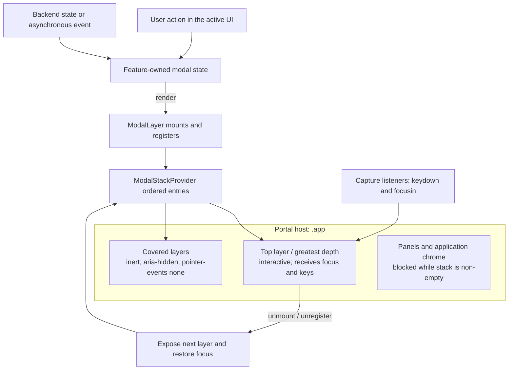

# Modal Stack

Full-screen dialogs share one frontend stack. The stack determines visual
depth, keyboard ownership, focus containment, and focus restoration; each
feature still owns the state that decides whether its dialog exists.

This is ephemeral UI state. It does not change backend authority, intent
semantics, or the WebSocket protocol.

---

## 1. Invariants

1. Every full-screen dialog is rendered through `ModalLayer`.
2. The most recently registered layer is the top layer.
3. Only the top layer is interactive and visible to assistive technology.
4. A key pressed while the stack is non-empty belongs to the top layer, never
   to a covered dialog or a panel.
5. Closing a layer restores the focus that existed immediately before it was
   opened, or focuses the newly exposed top layer when that target is gone.
6. Existing dialogs may remain visible below a translucent top layer, but are
   inert and cannot receive pointer, focus, or keyboard input.

---

## 2. Architecture

`ModalStackProvider` is mounted once above the application. A `ModalLayer`
portals its overlay into `.app` and appends a stable entry to the provider when
it mounts. Registration order is stack order; no central switch statement
needs to know every modal type.

Each layer exposes its position for diagnostics:

- `data-modal-id`: semantic dialog name
- `data-modal-depth`: zero-based stack position
- `data-modal-state`: `top` or `background`

The visual z-index is `100 + depth * 2`. A background layer is marked `inert`
and `aria-hidden`, and CSS disables its pointer events.

---

## 3. Push and Pop

### Push

When a feature renders a `ModalLayer`:

1. The layer captures the currently focused element as its restoration target.
2. It registers at the end of the ordered stack.
3. The previous top layer becomes a background layer.
4. Focus moves to `initialFocusRef`, an element marked
   `data-modal-initial-focus` or `autofocus`, the first focusable control, or
   finally the layer root. The layer entry keeps `initialFocusRef`, so every
   later refocus of the layer (after another layer pops without a usable
   restoration target, or when focus is redirected back into it) uses the same
   order. This matters when opening a dialog pops another layer in the same
   update, e.g. the command palette closing as the dialog it launched opens.

The visible dialog inside the layer is rendered through `ModalDialog` (or
`ResizableModal`, which composes it). This provides one `dialog` or
`alertdialog` role, an accessible label, and `aria-modal="true"` without
duplicating dialog semantics on the overlay.

User-triggered global commands that would open another modal are disabled
while the stack is non-empty. A modal may still explicitly open another modal,
and an asynchronous/backend-driven dialog may push above the current top.

### Pop

Unmounting a layer unregisters it. If it was the top layer, the next layer is
made interactive and focus is restored to the control that opened the removed
layer when possible.

A covered layer can disappear because its owning state changes. In that case,
the provider rewrites restoration references held by later layers. For example,
if focus moved `panel -> A -> B` and A disappears while B is open, closing B
restores focus to the panel rather than to a detached element from A.

---

## 4. Keyboard and Focus Ownership

The provider installs capture-phase `keydown` and `focusin` listeners while it
is mounted:

- `Tab` and `Shift+Tab` cycle through focusable controls in the top layer.
  Named radio groups contribute only their checked radio, or their first
  enabled radio when none is checked. Composite lists and tablists expose one
  sequential Tab stop and own their arrow-key navigation. A focused element
  inside `[data-modal-owns-tab]` receives `Tab` itself instead: the Pass to
  Bro list uses this so `Tab`/`Shift+Tab` move the selection like
  `ArrowDown`/`ArrowUp`. `Enter` and `Escape` remain the way out of such a list.
- Focus attempting to leave the top layer is redirected into it.
- A key event whose target is outside the top layer is stopped and redispatched
  from the top layer. This covers browser timing cases where a focused button
  becomes disabled or is removed between key events.
- All other events already inside the top layer continue to that modal's own
  handler. Thus only the top modal interprets `Escape`, `Enter`, arrows, or
  feature-specific shortcuts.

Panels receive a `modalActive` guard derived from `hasActiveModal`. The toolbar
uses the same value to suppress global commands while a modal is present;
application zoom shortcuts remain available. Modal components must not install
independent window-level keyboard listeners.

---

## 5. Scope and Integration Rules

The stack covers full-screen overlays only. Context menus, input-history
dropdowns, bookmark popovers, inline pairing confirmations, and separate
viewer/diff windows are not modal layers. A pairing request opens the Sharing
settings modal; its confirmation is rendered in that settings surface rather
than as a second layer.

When adding or converting a full-screen dialog:

1. Wrap its overlay with `ModalLayer` and give it a stable semantic `modalId`.
2. Keep open/close and payload state with the owning feature.
3. Put keyboard handling on the layer or its descendants, not on `window`.
4. Optionally provide `initialFocusRef` or mark the preferred control with
   `data-modal-initial-focus`.
5. Do not add another global `isAnyModalOpen` expression; consume
   `useModalStack()` where an application-level guard is required.
6. Test that a second layer leaves the first visible but inert, that only the
   top layer handles keys, and that focus returns correctly after each pop.

Resizable dialogs retain their last pointer-selected size. Edge and corner
handles, including the visible south-east affordance, are a pointer
enhancement; keyboard access to dialog content does not depend on resizing.

The implementation lives in `src/components/ModalStack.tsx`; shared visual
rules live in `src/styles.css`.
