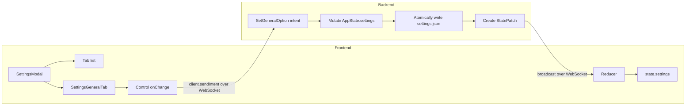

# Settings

## Overview

fbro has a persistent settings system backed by a typed state tree on the BE.
Settings are exposed through a tabbed modal dialog triggered by **Ctrl+,** (or **Cmd+,** on macOS).

## Design decisions

| Concern | Choice |
|---|---|
| Modal shape | Vertical tab list (left) + content area (right) |
| Trigger | Command `app.settings`, default binding **Ctrl+,** / **Cmd+,**, also reachable from the command palette |
| Apply model | Live-apply — no Save button. Each control dispatches its own typed intent on change; BE pushes `StatePatch` |
| Wire surface | Per-setting intents (typed). One fat `UpdateSetting { path, value }` intent was rejected. |
| Persistence | General settings → `settings.json`; local location settings → `fbro.sqlite3` |
| Defaults | Hardcoded in BE `Default` impls; missing or corrupt file → defaults silently, no error |
| Validation | Authoritative on BE. FE controls reflect `state.settings.*` after the BE confirms — no optimistic updates |
| Backdrop click | Does **not** close — settings is a considered action; explicit close (Esc or Close button) required |

## Architecture



## State snapshot

`settings` is included in the `StateSnapshot` envelope sent to every client on connect, so clients always have the current settings without a separate request.

`settings.general.supportsManagedThumbnails` is a read-only backend capability,
true on Linux and false for macOS/Windows native providers. It gates the Display
generation/cache controls and the Jobs modal's Thumbnails tab. It is not persisted
or writable through `SetGeneralOption`. Thumbnail streaming remains configurable
on all platforms. Settings patches merge with the snapshot and preserve this flag.

`settings.general.supportsOsNotifications` is a read-only backend capability,
true on Linux, in the packaged macOS `fbro.app`, and in the installed Windows
application whose Start Menu shortcut carries `dev.fbro.app`. It is false for
bare macOS and Windows development/test executables. It describes adapter
availability, independently of macOS user authorization and of the Windows
notification toggles. General settings shows **Show background OS
notifications** enabled only when this capability is true. The section is also
visible when `supportsOsNotificationSettings` is true (macOS and Windows,
including development builds), with a disabled delivery checkbox when native
delivery is unavailable. The macOS explanation says delivery requires the signed
fbro.app. The Windows explanation says delivery requires the installed fbro
application. `general.osNotificationPlatform` is the read-only host
(`linux`, `macos`, `windows`, or `none`) that selects this copy. It is projected
on the settings snapshot, omitted from later settings patches, and preserved by
the snapshot merge. It is not persisted or writable through `SetGeneralOption`.
The persistent
`general.osNotificationsEnabled` preference defaults to true; changing it updates
the native delivery policy immediately and then projects the authoritative backend
value. Unsupported platforms retain the preference without native delivery.
On macOS, enabling while a native window is focused also prepares the system
authorization prompt on the UI thread after releasing shared state. The callback
rechecks focus and the preference before requesting permission. System denial
does not change the persisted preference; permission is controlled separately by
System Settings → Notifications → fbro. See [notifications.md](notifications.md).

`general.supportsOsNotificationSettings` is a read-only PAL capability, true on
macOS and Windows, including bare development executables, and false by default
on other platforms. It is neither persisted nor writable. When true, General →
Notifications offers host-specific help. On macOS it explains that permission
must be enabled in **System Settings → Notifications → fbro** and that denial
prevents another prompt. On Windows it explains that banners are controlled in
**Settings → System → Notifications → fbro**, that Windows does not ask for
permission, and that Focus assist can hide banners. **Open notification settings** sends
`OpenOsNotificationSettings { requestId }` to the backend. The button is reachable
with Tab and native Enter/Space activation, retains its focus while opening,
guards duplicate requests and displays “Opening…”, and shows correlated failures
inline. Disconnect clears the pending request and reports an inline error.
The checkbox remains fbro's independent delivery preference; the notice does not
assert current system authorization. Opening the system pane never changes a
permission or the app preference.
The explanatory paragraphs live in an info tooltip beside the Notifications
heading, leaving the controls visible in the compact section. Its labelled info
button opens on hover, focus, or native activation. Escape dismisses the tooltip
before Settings, retains button focus, and subsequent Tab/blur dismisses it.
Opening the installed app's system pane does not initialize Notification Center
in the development executable. Development guidance is included in the same
tooltip. The preference is preserved across development
and packaged runs; the disabled control never claims delivery is available in dev.

```json
{
  "type": "StateSnapshot",
  "domains": {
    "settings": {
      "general": {
        "showHiddenDefault": false
      }
    }
  }
}
```

## macOS file icon cache

Settings → Display shows a File icons section only when the read-only backend
`general.iconCacheDir` is nonempty (macOS). PNGs persist under
`$HOME/Library/Caches/fbro/icons/v1`. The keyboard-accessible Clear file icon
cache button sends `ClearIconCache { requestId }`, disables itself with
“Clearing…” until the correlated reply, and shows errors inline. Disconnection
releases the pending state. Backend success publishes “Cleared file icon cache”.
The authoritative `general.iconCacheRevision` patch refreshes panel icon URLs;
visible icons may immediately repopulate the cache. Neither field is persisted
in settings.json or writable with `SetGeneralOption`.

## Intent: `SetGeneralOption`

**Direction:** FE → BE

```json
{
  "type": "Intent",
  "name": "SetGeneralOption",
  "args": {
    "key": "showHiddenDefault",
    "value": true
  }
}
```

Supported keys:

| Key | Type | Default | Effect |
|---|---|---|---|
| `showHiddenDefault` | `bool` | `false` | Whether new panels start with hidden files visible. Changing this also applies immediately to all open panels. |
| `showButtonBar` | `bool` | `true` | Show the classic bottom command bar. Settings → Display provides **Show bottom button bar**; the command palette provides **Toggle Button Bar** (`app.toggle_button_bar`, no default binding). Hiding the bar reclaims its space while preserving global shortcuts and zoom. The preference applies to all GUI clients connected to the backend. |
| `osNotificationsEnabled` | `bool` | `true` | Deliver selected operation notifications through the OS while no native fbro window is focused. Completion and cancellation require at least 30 seconds of execution; failures, pairing requests, transfer starts, and connection changes bypass that cutoff. The General settings control is capability-gated. See [notifications.md](notifications.md). |
| `rememberSortPerLocation` | `bool` | `false` | Remember and share sorting for each local filesystem location and for the Journal source. |
| `enableHeic2any` | `bool` | `false` | Enable local browser conversion of HEIC/HEIF previews in the embedded and detached viewers on Windows (including Windows 10) and Linux. The control is hidden on macOS, which retains native decoding. Existing image caps apply. Changes update open viewers through backend patches; conversion is preview-only and does not write files. |
| `zshEmacsKeymap` | `bool` | `false` | On macOS, start new interactive zsh terminals with `-o emacs`. The control is hidden and the setting has no effect on other platforms. Other shells and Quick Edit commands are unaffected. Existing terminal sessions keep their current keymap. |
| `fedupDefaultIgnorePatterns` | `string` | `.git`, `.idea`, `.vscode`, `.venv`, `node_modules`, `__MACOSX`, `._*`, `.DS_Store`, `artifacts/e2e`, `dist/assets`, `target/debug`, `target/release`, `target/bundle`, `.m2` | Newline/comma separated wildcard name/path patterns Fedup Bro can use to skip files and folders before scanning. |

Unknown key or type mismatch → `Error { code: "BAD_SETTING", recoverable: true }`.

Button bar visibility persists as `general.show_button_bar` in `settings.json`.
Older settings files without the field default to visible. Both controls use
`SetGeneralOption`; visibility changes only after a backend settings patch.

OS notification preference persists as `general.os_notifications_enabled`.
Older settings files without this field default to enabled. A non-boolean value
is rejected; the capability `supportsOsNotifications` is neither persisted nor
writable through `SetGeneralOption`.

## StatePatch: settings domain

Detached viewer clients receive the current `general.enableHeic2any` in their
initial lightweight display-settings patch, as well as subsequent changes.
HEIC2ANY decoding errors from its older libheif can fall back to the bundled,
lazy-loaded `heic-to` browser decoder under the same toggle.

When a setting changes the BE broadcasts a patch to all connected clients:

```json
{
  "type": "StatePatch",
  "domain": "settings",
  "version": 0,
  "patch": {
    "general": {
      "showHiddenDefault": true
    }
  }
}
```

## Persistence

All persistent settings are owned and written by the BE. The FE sends typed
intents and updates its projection from `StatePatch`; it never writes these
files directly.

The configuration directory is:

| Platform | Directory |
|---|---|
| Linux and macOS | `$XDG_CONFIG_HOME/fbro`, falling back to `$HOME/.config/fbro` |
| Windows | `%USERPROFILE%\.config\fbro` |

### Storage map

| File | Contents | Format and write behavior |
|---|---|---|
| `settings.json` | `GeneralSettings`, saved panel view modes, modal sizes, and the internal location-sort retention timestamp | Pretty-printed JSON using Rust `snake_case` field names. The complete `Settings` value is rewritten after an accepted JSON-backed settings change. |
| `fbro.sqlite3` | Mutable structured application state. Currently the `settings_location` table stores sort column and direction by normalized local path or Journal source key. | SQLite. Settings tables use a `settings_` prefix. Sort changes use an UPSERT; reset and retention expiry use `DELETE`. `PRAGMA user_version` versions its schema. |
| `journal.sqlite3` | Audit events, including outcomes of manual location-sort resets and automatic expiry cleanup. | Append-only SQLite `journal_events`; ordinary setting changes are not journaled. It does not store current setting values. |

`session.toml` and `bookmarks.toml` share the configuration directory but are
not settings stores. `session.toml` holds restorable window/panel/tab state;
settings such as `remember_window_state` and `persist_panel_tabs` decide which
of that state is written. `bookmarks.toml` owns the bookmark list.

### `settings.json`

Writes are atomic: content is written to `settings.json.tmp` then renamed over `settings.json`. A crash between the two steps leaves a stale `.tmp` file but the last good `settings.json` intact.

On startup, a missing or unparseable file is loaded as hardcoded defaults with
no user-facing error. The file on disk is not rewritten until the next
successful settings save. Missing fields that carry Serde defaults are filled
individually, allowing compatible settings additions.

### Local location settings

Preferences associated with a local filesystem directory or the Journal source are stored in the
`settings_location` table of `fbro.sqlite3`. This database owns mutable,
structured application state; the separate `journal.sqlite3` database remains
an append-only audit log. The domain model is `LocationSettings`; sorting is
its first setting and consists of the sort column plus direction.

Schema version 2 uses the `settings_location` name. It migrates version 1
`fbro.sqlite3` databases from `location_settings`, and also migrates valid rows
from the older `journal.sqlite3` location table. Each old table is removed after
its rows are copied. Existing `journal_events` are not modified.
`PRAGMA user_version` tracks future `fbro.sqlite3` schema migrations.

Filesystem rows are keyed by normalized absolute local path. Journal uses the
reserved `source:journal` key independently of its empty/slash root, so its
preference cannot collide with the filesystem root. No schema migration is
needed, and existing filesystem keys retain their meaning. Rows are loaded into
`AppState.location_settings` at startup and updated with an UPSERT whenever
sorting changes while **Remember sorting per location** is enabled. Panels and
tabs then share the same preference for a location, and an unseen location uses
name ascending. When disabled, sorting remains panel-local and navigation keeps
the panel's current sort. Journal follows the same enable/disable, sharing,
reset, remembered-location count, and 30-day retention policy. Remote, archive,
search, and other virtual sources do not participate.

The General settings UI reports the number of valid remembered locations and
offers a confirmed reset. Disabling retains rows for 30 days; re-enabling within
that window reuses them. Expired rows are removed at the next startup or
re-enable attempt. Manual resets and expiry cleanup record their outcomes and
removed counts in the append-only audit journal.

Ordinary location-setting writes are storage only and are not added to the
visible journal.

## Key files

| File | Role |
|---|---|
| `src-tauri/src/config.rs` | Resolves the platform-specific configuration directory |
| `src-tauri/src/state/settings.rs` | `Settings` / `GeneralSettings` structs and JSON `load()` / `save()` |
| `src-tauri/src/state/location_settings.rs` | SQLite-backed per-location settings model and persistence |
| `src-tauri/src/ws/intents/settings.rs` | `SetGeneralOption` intent handler |
| `src-tauri/src/ws/protocol.rs` | `SettingsSnapshot`, `GeneralSettingsSchema` |
| `src-tauri/src/ws/commands.rs` | `app.settings` command + Ctrl+,/Cmd+, binding |
| `src/ws/types.ts` | `GeneralSettings`, `SettingsState` TypeScript types |
| `src/store/index.ts` | `settings` slice, `pendingSettings`, `OPEN_SETTINGS`/`CLOSE_SETTINGS` |
| `src/components/SettingsModal.tsx` | Modal shell — tab sidebar + content area |
| `src/components/SettingsGeneralTab.tsx` | General tab content |

## Adding a new tab

1. Add a slice to `Settings` (BE) and `SettingsState` (FE).
2. Add typed intents for its mutations (BE handler + FE `sendIntent` calls).
3. Write `SettingsXTab.tsx`.
4. Add the tab id to `TABS` in `SettingsModal.tsx`.
5. No changes to the modal shell or state machinery needed.
