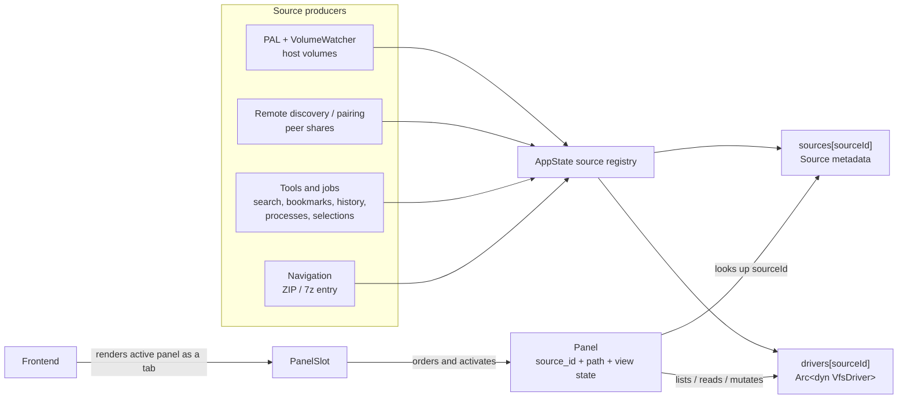
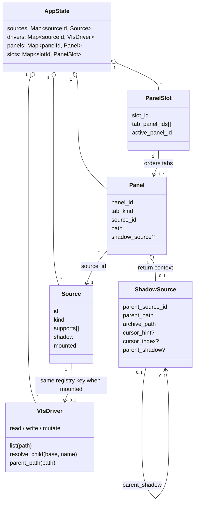
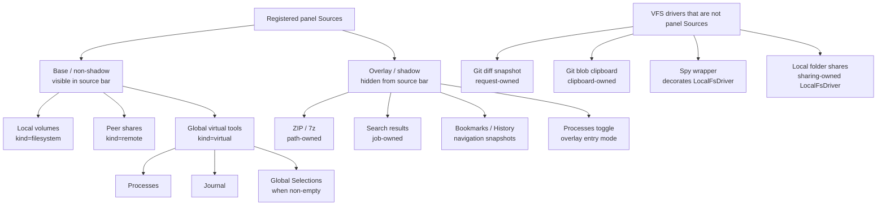
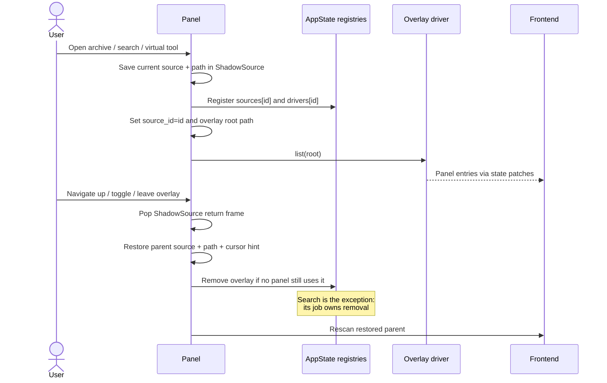
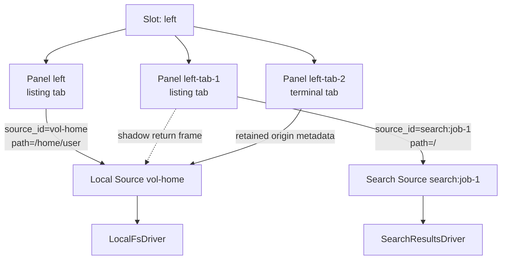

# fbro Source Architecture

This document is the implementation-first map of how fbro turns platform
resources and application datasets into things a panel can browse. It connects
the [Platform Abstraction Layer](platform.md), [VFS](vfs.md),
[protocol](proto.md), and [tab model](tabs.md).

The shortest useful mental model is:

> PAL discovers host resources. A VFS driver implements behavior. A Source
> publishes one driver under a global ID. A Panel (and therefore a listing tab)
> selects that Source ID plus a path.

A source is not a tab, and a VFS driver is not necessarily a source.

---

## 1. The layers



### 1.1 PAL: host integration, not the source abstraction

The PAL answers OS-specific questions such as the home directory, native
volumes, mounting, disk space, icons, thumbnails, application launch, and the
host clipboard. `Platform::list_volumes()` seeds startup state and the async
`VolumeWatcher` supplies the canonical inventory and hot-plug changes.

PAL volume records become local filesystem Sources, but PAL does not create
remote, archive, search, or other virtual Sources. Those are produced by their
own backend subsystems. PAL also does not implement filesystem operations;
that is the VFS driver's job.

### 1.2 VFS driver: behavior

`VfsDriver` is the backend interface for listing, path navigation, reads,
writes, metadata, recursive traversal, transfer digests, and optional remote
services. Paths are meaningful only to the selected driver.

Driver properties such as `is_local()` and `supports_thumbnails()` are runtime
facts. They are independent of the protocol's Source `kind` and `shadow`
fields. For example, search results are virtual and shadowed, but their driver
can still advertise thumbnails because entries carry real host paths.

### 1.3 Source: globally registered metadata

`AppState` normally contains matching entries under the same key:

```text
sources[source_id] -> Source metadata
drivers[source_id] -> Arc<dyn VfsDriver>
```

The `Source` record supplies the frontend-visible identity and coarse policy:

| Field | Meaning |
|---|---|
| `id` | Global lookup key used by panels, jobs, history, and protocol messages. |
| `name` | Human-readable label; not necessarily the tab title. |
| `kind` | Runtime wire classification: `filesystem`, `virtual`, or `remote`. |
| `supports` | Fine-grained operation/navigation flags. |
| `root_path` | Root in the driver's path space; may be empty for virtual/remote drivers. |
| `mounted` | Whether the source currently has a usable driver. |
| `eject` | Optional backend-projected removable-volume actions, drive label, and mounted sibling count; absent for internal, remote, virtual, and unmounted sources. |
| `shadow` | Transient/overlay source; hidden from the source bar. |
| `read_only` | Backend policy flag, separate from `shadow`. |
| `sort_priority`, `icon_name` | Source-bar presentation hints. |
| `peer_id` | Owning paired peer for remote Sources. |

Sources are global backend objects. Multiple panels may point at the same
source simultaneously.

### 1.4 Panel and tab: a view into a source

A listing tab is a `Panel` record. It owns `source_id`, the current driver path,
sort/filter/view state, cursor, selection, history, and optional shadow return
context. Thumbnail work belongs to the active panel's source/location lifetime:
leaving that location or hiding/removing the listing clears its queue and
signals active generation to stop. A same-location rescan preserves admitted
work while updating the request epoch; another displayed panel retains its work
(see [Thumbnails](thumbnails.md)). A `PanelSlot` owns an ordered list of panel IDs and selects one active
panel. The React tab chip is only a projection of that backend state.



The source does not own panel UI state. Two tabs on one source can have
different paths, sorts, filters, cursors, and selections.

---

## 2. Source hierarchy

The hierarchy below classifies registered panel Sources by visibility and
lifetime. It deliberately keeps the three wire `kind` values separate from the
orthogonal `shadow` flag.



“Base” here means directly selectable and non-shadow, not necessarily local or
persistent across application restarts. Remote Sources, for example, exist
only while their peer connection is registered.

User-entered folder shares own internal `share-folder:<target-id>` driver keys
without corresponding local panel Sources. Sharing registers/removes these
drivers and restores them from share.json, independently of volume inventory.
The peer mounts each shared root as a normal remote Source. See
[Remote fbro](remote-fbro.md#shared-folders).

---

## 3. Supported source catalog

### 3.1 Tab-browsable Sources

| Family | Source IDs | Producer | Driver | `kind` / `shadow` | Source bar | Lifetime |
|---|---|---|---|---|---|---|
| Local volumes | PAL/volume-watcher IDs such as `vol-root` or platform-native IDs | PAL startup inventory and `VolumeWatcher` reconciliation | `LocalFsDriver`, optionally wrapped by `SpyFsDriver` | `filesystem` / `false` | Yes | Application lifetime, updated on mount/hot-plug |
| Remote peer shares | `remote:<peer-fingerprint>:<remote-source-id>` | Remote pairing/connect flow | `SftpFsDriver` | `remote` / `false` | Yes | Connection/session; removed on disconnect |
| Processes | `procs` | Startup state, settings, or Processes toggle | `ProcsDriver` | Usually `virtual` / `false`; toggle entry currently re-registers it as shadow | Yes when non-shadow | Application state or overlay lifetime, depending on entry path |
| Journal | `journal` | Startup state | `JournalDriver` | `virtual` / `false` | Yes | Application lifetime |
| Global Selections | `global-selections` | Global-selection store | `GlobalSelectionDriver` | `virtual` / `false` | Yes while present | Source metadata exists only while at least one named selection exists |
| Bookmarks | `bookmarks` | `EnterBookmarkSource` | Snapshot `BookmarksDriver` | `virtual` / `true` | No | Created/refreshed on entry; removed after the last panel exits |
| History | `history` | `EnterHistorySource` | Snapshot `HistoryDriver` | `virtual` / `true` | No | Created/refreshed on entry; removed after the last panel exits |
| Search results | `search:<job-id>` | Search job | `SearchResultsDriver` over a live result store | `virtual` / `true` | No | Job-owned; retained until `RemoveSearchSource` |
| ZIP archive | `zip:<absolute-archive-path>` | Archive navigation | `ZipFsDriver` | `virtual` / `true` | No | Mounted on entry; removed after the last panel exits |
| 7z archive | `7z:<absolute-archive-path>` | Archive navigation | `SevenZipFsDriver` | `virtual` / `true` | No | Mounted on entry; removed after the last panel exits |

Opening a local directory symlink resolves its target and selects the mounted
local Source containing that canonical path. The panel path uses the resolved
target, while the listing row and file jobs still identify the symlink itself.
The backend retains a per-panel return route: Up within the target's children
uses normal parent navigation, but Up at the target directory returns to the
source and directory where the link was opened, with the link selected. Nested
links return in reverse entry order. History Back/Forward restores these return
routes; Back to the link's origin also selects the link. Return routes are
session-only and do not change the canonical paths used for file operations.

The source bar renders every `Source` for which `shadow == false`; it is not
restricted to physical volumes. Sorting uses `sort_priority`, then a
case-insensitive name comparison.

Mounted removable volumes expose a right-click menu with **Unmount volume…**
and, when the platform supports it, **Eject entire drive…**. The command
palette opens the same source/action picker. Unmount affects only the selected
volume; whole-drive eject affects all mounted sibling volumes and displays a
warning with the backend-reported count. Successful removal or unmount moves
panels using unavailable sources to Home. The backend re-enumerates and
validates the action before touching a device.

### 3.2 VFS drivers outside the panel-source hierarchy

Not every `VfsDriver` gets a `Source` record or can back a normal tab:

| Driver | Owner | Use |
|---|---|---|
| `GitDiffSnapshotDriver` | One compare request | Supplies two in-memory, read-only files to the diff viewer. It is deliberately not inserted into `AppState.sources`. |
| `GitBlobDriver` | Session clipboard state | Streams a historical Git blob for paste/copy through the driver registry under `git-blob-clipboard`; it is not a source-bar or panel source. |
| `SpyFsDriver` | Debug/test configuration | Wraps `LocalFsDriver` and intercepts operations. The published Source remains the same local filesystem Source. |

This distinction matters when adding a driver: implementing `VfsDriver` alone
does not make it navigable. A panel source additionally needs registry
metadata, a lifecycle owner, and navigation wiring.

---

## 4. Classification axes

Source families cannot be accurately represented by one inheritance tree.
They are the product of several independent axes.

### 4.1 `kind`

The live protocol and frontend use three values:

| Kind | Meaning |
|---|---|
| `filesystem` | A mounted local OS filesystem with host paths. |
| `remote` | A peer-backed filesystem accessed through `SftpFsDriver`. |
| `virtual` | Application data or a driver-defined namespace: archives, search, processes, Journal, bookmarks, history, and selections. |

Older passages in `vfs.md` describe only `filesystem | virtual`. Treat those
as the conceptual split that predates the explicit remote wire kind; the code
and TypeScript schema are authoritative for the current three-value model.

### 4.2 `shadow`

`Source.shadow` answers a presentation/lifecycle question: is this Source a
transient overlay that should stay out of the source bar? It does not answer
whether the driver is local, hierarchical, read-only, or navigable.

At serialization time the backend derives coarse capabilities as follows:

```text
capabilities.readOnly       = source.shadow || source.read_only
capabilities.supportsJobs   = !source.shadow && !source.read_only
capabilities.supportsStreaming = true
```

These coarse fields do not replace `supports` or driver-specific validation.
For example, an archive is a shadow/read-only destination but can advertise
`CopySelection` as a source.

### 4.3 Fine-grained `supports`

The important current flags are:

| Flag | Meaning |
|---|---|
| `ListEntries` | Enumerate the current path. |
| `OpenFolder` | Directory entries can be opened. |
| `CopySelection` | Entries may be used as a copy source. |
| `MoveSelection` | Entries may be moved where the backend permits it. |
| `DeleteSelection` | The exposed object can be deleted or removed; semantics may be virtual. |
| `InspectItem` | Rich per-entry metadata is available. |
| `Rename`, `Edit`, `Touch`, `NewFolder`, `OpenShell` | Local filesystem operations. |
| `InternalNavigation` | Opening a directory remains inside this driver instead of handing off to a real filesystem source. |

Capabilities describe application semantics, not merely Rust trait methods.
Global Selections demonstrates the distinction: `DeleteSelection` deletes a
selection or reference, never the referenced filesystem object.

### 4.4 Navigation mode

There are two directory-entry behaviors:

- **Internal navigation**: archives, hierarchical Processes, and Global
  Selections interpret child paths within the same driver.
- **Handoff navigation**: Bookmarks, History, and search result directories
  point at real filesystem locations. Opening them resolves the best local
  filesystem Source and leaves the virtual view.

`InternalNavigation` is independent of `kind` and `shadow`.

### 4.5 Path ownership

`Panel.path` is always a path in the active driver's namespace:

- local Sources use host filesystem paths;
- remote Sources use SFTP-relative paths;
- archives use paths inside the archive, rooted at `""`;
- search uses a flat virtual root at `"/"`;
- several virtual roots use `""`.

Code outside the driver must not infer semantics from path punctuation. When a
virtual entry references a real file, `VfsEntry.source_path` carries the real
path explicitly.

Search-result Jump to location and Open With use this full-path identity,
including when results share a filename or arrive in a different order than
the panel listing. Jump hands the same panel to a mounted local source after
validating the target, with a cursor hint for the file. It removes only that
panel's shadow context; the search source, driver, store, and job remain registered.

---

## 5. Shadow Sources and return context

Two similarly named objects participate in an overlay:

1. `Source { shadow: true }` is the globally registered overlay and driver.
2. `Panel.shadow_source: Option<ShadowSource>` is that panel's return frame.

The return frame records the parent source/path and cursor restoration hints.
`parent_shadow` forms a linked stack for nested overlays—for example, opening a
ZIP archive from a search result and then returning to the same search row.



### 5.1 Sharing and cleanup

Shadow Sources still live in the global registries. Two panels can therefore
use the same archive or search Source. Generic teardown removes a non-search
shadow Source only after no other panel points to it.

Search differs because navigating away must not destroy the job's results.
`RemoveSearchSource` owns cancellation, panel migration, store/driver/source
removal, and job removal.

Bookmarks and History use singleton source IDs and refresh their snapshot
driver when entered. Their panel return contexts remain separate even though
the registered driver is shared by ID.

### 5.2 Processes implementation exception

Processes is registered at startup as a non-shadow global virtual Source, so it
can appear in the source bar. The `EnterProcsSource` toggle path currently
re-registers the same `procs` ID as `shadow: true` and attaches a return frame.
Consequently Processes has both direct-source and overlay-style entry modes.
This is current behavior, not a general rule for virtual Sources.

---

## 6. How Sources map to tabs



### 6.1 Listing tabs

Every listing tab is one Panel bound to one active Source. Switching tabs does
not change a Source; it activates another Panel with its own binding and view
state. Navigating to another Source mutates the existing Panel.

Tab labels are presentation, not source identity. Normal listing tabs derive
their labels from the path. Search tabs display their `search:<job-id>` source
ID, while the Processes and Journal roots display their source names, avoiding
an ambiguous `"/"` label for flat virtual sources.

### 6.2 Terminal tabs

A promoted terminal is still represented by a Panel with `tab_kind=terminal`.
It retains source/path metadata from its origin, but the tab renders its PTY
instead of calling the source driver for a listing. A terminal is not a Source.

### 6.3 Creating a new tab

All New Tab entry points use the active Panel:

- an active mounted, non-shadow, local filesystem listing is cloned;
- an active remote, virtual, shadow, or terminal tab creates a clean listing
  at the user's Home directory and its owning local Source.

This prevents a new tab from inheriting a virtual source without the required
job or shadow return context.

### 6.4 Persistence and removal

Session persistence stores listing source IDs and paths, not live drivers or
shadow return stacks. If a saved Source is unavailable at restore, the panel
falls back to a valid local/Home context. Terminal sessions are not restored as
live PTYs.

Closing a tab removes a Panel, not necessarily its Source. Source cleanup is
owned by the producer/lifecycle described in the catalog. Search removal
explicitly migrates referencing panels before deleting its Source. Remote
disconnect currently removes the peer's Source and driver registrations
directly; a stale panel is recovered through the unavailable-source/Home
fallback on a subsequent restore or navigation. That asymmetry is a current
implementation caveat.

---

## 7. Source data across the protocol boundary

The backend is authoritative. It emits Source snapshots/patches containing
metadata and coarse capabilities; the frontend indexes them by ID. Panel
snapshots carry `sourceId`, `path`, and optional `shadowSource` separately.

The frontend uses Source metadata for the source bar, operation gating,
thumbnails, remote badges, and search-location choices. It does not instantiate
drivers or enumerate files directly.

The two related capability surfaces serve different purposes:

- `supports[]` describes explicit application operations and navigation.
- `capabilities` provides broad read-only/streaming/job hints derived by the
  backend.

Backend intent handlers and jobs must still validate the live Source and
driver; frontend gating is not an authorization boundary.

---

## 8. Reading older specifications

The implementation has evolved beyond a few older statements:

- Source `kind` now includes `remote` in addition to `filesystem` and
  `virtual`.
- Sources are not all immutable for a full session; hot-plug volumes, remote
  connections, global selections, jobs, and overlays add or remove them.
- `shadow` is a global Source attribute, while the return stack is per Panel.
- A driver can exist without a frontend-visible Source.

Use this document for the cross-subsystem model, then consult the focused
documents for details:

- [platform.md](platform.md): PAL and volume discovery
- [vfs.md](vfs.md): driver contract and jobs
- [tabs.md](tabs.md): panel/slot/tab lifecycle
- [search.md](search.md): job-owned search Sources
- [remote-fbro.md](remote-fbro.md): peer Sources and SFTP transport
- [proto.md](proto.md): wire schemas and patches

---

## 9. Adding a new panel Source

Use this checklist to keep the layers separate:

1. Implement or reuse a `VfsDriver`; define its path and entry semantics.
2. Choose a globally unique Source ID and a lifecycle owner.
3. Register matching `sources[id]` and `drivers[id]` entries.
4. Set `kind`, `shadow`, `read_only`, `root_path`, presentation hints, and
   fine-grained `supports` deliberately.
5. Decide whether directory entries navigate internally or hand off to another
   Source.
6. If it is an overlay, attach a per-Panel `ShadowSource` and define cleanup,
   sharing, nesting, and cursor restoration.
7. Define what happens when tabs are created, restored, closed, or left pointing
   at the Source during removal.
8. Emit Source and Panel patches in an order that never leaves the frontend
   referencing an unknown ID.
9. Test capability gating, path resolution, multi-panel use, teardown, and
   unavailable-source recovery.

## Viewer target resolution

Quick preview and F3 share the backend viewer resolver. A preview invalidates its
target when the source panel cursor/location/entry changes, then asks the backend
for that cursor's file. Search entries are resolved by real path, preserving the
correct source when names repeat. Local file symlinks resolve to the target file
and its source; directory links are directory placeholders. Open viewer carries
the resolved source/path, so a later source-panel cursor change cannot silently
open a different file.
