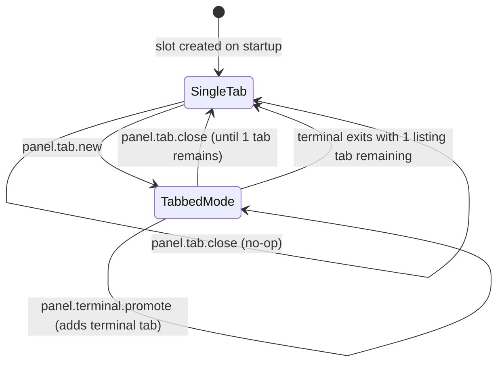
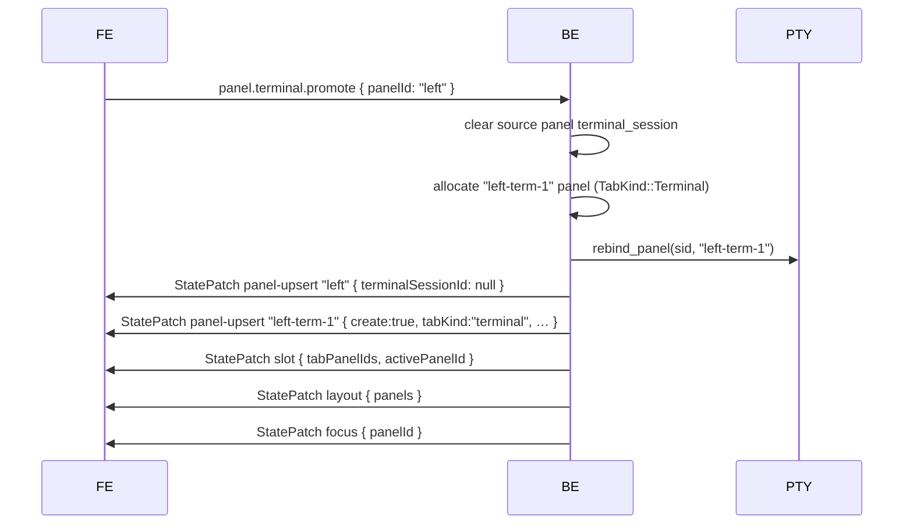
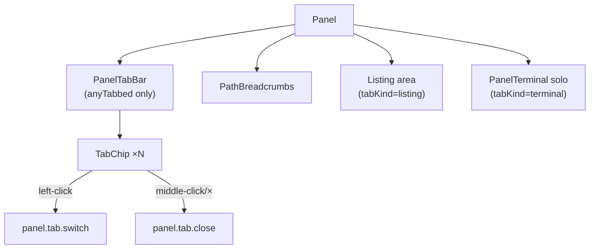

# Tabbed Panel Mode

Each layout slot can host multiple **tabs**. A tab is a full panel record — it preserves its own cursor position, selection, sort order, scroll offset, and view mode. Tabs are invisible while a slot has only one; the tab bar surfaces automatically once a second tab is opened ("implicit tabbed mode").

---

## 1. Concepts

| Term | Definition |
|---|---|
| **Slot** | A layout position (e.g. `"left"`, `"right"`). Groups one or more panels as tabs. |
| **Panel** | One tab inside a slot. Owns a full directory listing state, a live PTY session, or a built-in editor session. |
| **TabKind** | `listing` (folder view, default), `terminal` (promoted PTY), or `editor` (built-in editor, §5a). |
| **Active tab** | The panel currently visible in the slot. Only this panel receives keyboard events and renders its content. |
| **Implicit mode** | The tab bar is only rendered when `slot.tabPanelIds.length > 1`. Single-tab slots look identical to the pre-tabs UI. |

---

## 2. Data Model

### 2.1 Backend (`src-tauri/src/state/mod.rs`)

```rust
pub enum TabKind { Listing, Terminal, Editor }

pub struct PanelSlot {
    pub slot_id: String,
    pub tab_panel_ids: Vec<String>, // ordered, len >= 1
    pub active_panel_id: String,
    pub version: u64, // incremented for each emitted slot patch
}

// Added to Panel:
pub slot_id: String,
pub tab_kind: TabKind,
pub tab_title_override: Option<String>,
pub editor: Option<crate::editor::EditorTab>, // TabKind::Editor only
```

`AppState` carries:

```rust
pub slots: HashMap<String, PanelSlot>,
pub layout_slots: Vec<String>,   // ordered slot ids (drives visible layout)
```

`layout.panels` is kept as the parallel list of **active panel ids per slot** for back-compat; code that understands slots should read `layout_slots` and dereference via `slots[slotId].activePanelId`.

### 2.2 Frontend (`src/ws/types.ts`, `src/store/index.ts`)

```ts
interface PanelSlot {
  slotId: string;
  tabPanelIds: string[];
  activePanelId: string;
  version: number;
}

// PanelState (existing) gains:
slotId: string;
tabKind: "listing" | "terminal" | "editor";
tabTitle?: string;
editor?: EditorTabInfo; // { sessionId, filePath, fileName, originPanelId, savedVersion, isNote }

// AppState gains:
slots: Record<string, PanelSlot>;
layoutSlots: string[];
```

`focus` continues to address a **panel id** (the active tab's panel). All existing focus logic is unchanged.

Only active listing tabs contribute their actual viewport to thumbnail
generation priority. Creating, switching, closing, or promoting a tab refreshes
the pool's visibility set, so hidden tabs' work waits for the background cooldown.

---

## 3. Tab Lifecycle

### 3.1 State machine



### 3.2 New tab (`panel.tab.new`)

1. If the active panel is a local filesystem listing, clone its `source_id`, `path`, and backend symlink return context; otherwise use the local source containing the user's Home directory and start at Home.
2. Allocate a new panel id; insert it after the active tab in `tab_panel_ids`.
3. Set `active_panel_id` to the new panel id; update `focus`.
4. Emit targeted patches: `panel-upsert` (create:true), `slot`, `layout`, `focus`.

### 3.3 Switch tab (`panel.tab.switch`)

1. Set `slot.active_panel_id` to the requested panel id.
2. Update `AppState.focus` if the slot is focused.
3. Emit: `slot` patch + `layout` patch + `focus` patch. No full snapshot.

### 3.4 Close tab (`panel.tab.close`)

1. If the slot has only one tab → no-op. An editor tab is the exception: it
   turns into a listing of its file's folder (`tabKind: "listing"`,
   `editor: null` patch, then a normal navigation).
2. Remove the panel id from `tab_panel_ids`; remove the `Panel` record.
3. Activate the tab to the left (or the new first tab if the closed tab was leftmost).
4. Emit: `slot` patch + `layout` patch + `focus` patch + `panel-remove` patch.
5. An editor tab first waits for any save in flight, and afterwards discards
   an untouched new note (§5a.4).

### 3.5 Terminal promotion (`panel.terminal.promote`)

1. Read `source_panel.terminal_session = Some(sid)`.
2. Clear `terminal_session` on the source panel → returns it to listing view.
3. Allocate a new panel id; build `Panel { tab_kind: Terminal, terminal_session: Some(sid), … }`.
4. Insert the new panel after the source in `tab_panel_ids`; activate it.
5. Call `pty_manager.rebind_panel(sid, new_panel_id)` so natural-exit cleanup targets the new tab.
6. Emit: `panel-upsert` (source, terminal_session cleared) + `panel-upsert` (new terminal tab, create:true) + `slot` + `layout` + `focus` patches.



### 3.6 Reorder tab (`ReorderPanelTab`)

Move `panelId` immediately before `beforePanelId` within `slotId`; an explicit
`null` target appends it. Resolve both identities against the current backend
order. Missing/malformed arguments, unknown slots/tabs, cross-slot references,
self-targets, and unchanged positions are no-ops. Only `tab_panel_ids` changes;
active tab, focus, listing state, and PTY ownership stay intact. Broadcast a
targeted slot patch containing `tabPanelIds` and the unchanged `activePanelId`,
without a snapshot or layout/focus patch. Slot patch producers and natural
terminal-exit snapshots share a per-slot monotonically increasing version.
Snapshots expose the slot's current version. The frontend rejects older or
duplicate slot updates, resetting its version baseline on a new connection.
Reordering is recorded in the command journal.

---

## 4. Protocol

### 4.1 Intents (FE → BE)

| Intent | Payload | Description |
|---|---|---|
| `panel.tab.new` | `{ slotId, source: "clone" }` | New tab cloning active source + path. |
| `panel.tab.close` | `{ panelId }` | Close tab; no-op when it's the only tab. |
| `panel.tab.switch` | `{ slotId, panelId }` | Activate a tab. |
| `ReorderPanelTab` | `{ slotId, panelId, beforePanelId: string \| null }` | Move before a sibling, or append when target is null. |
| `panel.tab.rename` | `{ panelId, title }` | Override tab title (protocol only, no UI yet). |
| `panel.terminal.promote` | `{ panelId }` | Promote embedded PTY to sibling tab. |
| `OpenEditorTab` | `{ panelId, requestId, path, filename }` | Open (or activate) an editor tab for a listing entry, after the requesting tab. |
| `ReturnToOriginTab` | `{ panelId }` | From an editor tab: activate its origin listing tab (§5a.3). |

Editor file intents (`LoadEditorSession`, `SaveEditorFile`, …) and the note
intents that open editor tabs are listed in [Protocol](proto.md).

### 4.2 Patches (BE → FE)

All tab operations use **targeted patches** — no full `StateSnapshot` is emitted.

| Domain | Payload | When |
|---|---|---|
| `panels` | `{ create:true, slotId, tabKind, … }` | New tab created |
| `panels` | `{ remove:true }` | Tab closed |
| `panels` | `{ terminalSessionId: null }` | Source panel cleared on promote |
| `panels` | `{ editor }` (version 0) | Editor tab state changed: `savedVersion` after a save, reload, or Keep both |
| `panels` | `{ tabKind: "listing", editor: null }` (version 0) | A lone editor tab became a listing |
| `slots` | `{ tabPanelIds, activePanelId }` | Any tab membership/order/activation change |
| `layout` | `{ panels: […] }` | Whenever `layout.panels` (active-per-slot list) changes |
| `focus` | `{ panelId }` | Active panel changed |

---

## 5. Terminal Tabs

### 5.1 PTY ownership

The PTY session (`PtySession`) carries its owning panel id as `Arc<Mutex<String>>`. This shared reference lets the wait-for-exit thread always read the **current** owner, even if the session was promoted after spawn.

```
PtySession.panel_id: Arc<Mutex<String>>
                          ↑ shared with wait-for-exit thread
```

`rebind_panel(sid, new_panel_id)` writes through this `Arc` without restarting the process.

### 5.2 xterm.js buffer preservation

Switching away from a terminal tab unmounts the React component. To keep the buffer and scrollback alive the FE uses a **module-level cache** keyed by session id:

```ts
const TERM_CACHE = new Map<number, CachedTerm>();
// { terminal: Terminal, fitAddon: FitAddon, element: HTMLElement }
```

On unmount the DOM element is detached but the `Terminal` instance is kept. On remount the same instance is reattached and `fitAddon.fit()` is called. The cache entry is removed only when `TerminalClosed` arrives.

### 5.3 Auto-close on shell exit

When the shell exits naturally (user typed `exit` or the process died):

1. The wait-for-exit thread checks `tab_kind == Terminal`.
2. If the slot has more than one tab → remove the terminal tab and activate the left neighbor (same logic as `panel.tab.close`).
3. If it's the only tab → clear `terminal_session` and keep the panel (it reverts to an empty listing).
4. Emit `TerminalClosed` + the appropriate `slot` / `layout` / `focus` patches.

---

## 5a. Editor Tabs

A built-in CodeMirror editor for small text files, notes first. The backend
owns the file (load, change detection, every write); the frontend owns only
the text being edited.

### 5a.1 Data model

An editor tab is a `TabKind::Editor` panel whose `source_id` / `path` are the
edited file's local source and folder. Its listing fields describe that folder:
the panel is scanned like a hidden listing so the existing folder watcher,
reconnect rescans, and source recovery apply to it unchanged. `Panel.editor`
carries:

| Field | Meaning |
|---|---|
| `session_id` | Frontend cache key; new for every tab, including restored ones |
| `file_path` | Canonical local path (symlinks resolved at open, so the link survives saves) |
| `origin_panel_id` | Listing tab that Escape returns to |
| `created_note` | `{ store_id, note_id }` for a note created by `CreateNote` |
| `saved_version` | Bumped on every save, reload, and Keep both; quick preview refreshes on it |
| `disk` | Hash, line ending, BOM of the bytes last loaded or saved (`None` until loaded) |

One editor tab exists per canonical path across all slots; opening the same
file again activates it.

### 5a.2 Opening

`OpenEditorTab` resolves `{ path, filename }` against the requesting listing
(like Quick Edit), then the shared `open_editor_tab` checks the file itself:
local driver, regular file, at most 2 MiB, UTF-8. Refusals reply
`EditorOpenFailed { code: NOT_LOCAL | NOT_REGULAR_FILE | TOO_LARGE | NOT_UTF8 | MISSING | IO }`
and leave focus where it was. The new panel is inserted right after the
requesting tab and activated; patches go out `panel-upsert` (create, with
`editor`) → `slot` → `layout` → `focus`.

The **origin** is always a listing tab: the requesting tab when it is a
listing; else, from an editor tab, that tab's own origin; else the nearest
listing tab in the same slot (left first); else none.

### 5a.3 Returning and closing

`ReturnToOriginTab` activates the origin. Its cursor moves to the edited file
only when its listing shows it; otherwise the cursor is unchanged. When the
origin is gone, a new listing tab of the file's folder opens after the editor
tab, with the cursor on the file. The editor tab stays open either way.

### 5a.4 Saving

Autosave and all key handling are frontend concerns; see
[Keyboard](keyboard.md) §3a. The backend's `SaveEditorFile` (serialized per
tab, not an `AppJob`: a single small write with nothing to report, cancel,
pause, or skip):

1. Unless `force`, compares a blake3 hash of the file with the hash it last
   loaded or saved. Size and mtime are not used: a same-second, same-size
   edit keeps them and a bare `touch` changes them. A mismatch replies
   `STALE`; a missing file replies `MISSING`.
2. Restores the loaded line ending (LF/CRLF) and UTF-8 BOM. The final newline
   is exactly what the buffer contains.
3. Writes `.<name>.fbro-tmp-<random>` with `open_write_new`, copies the target's
   permissions, syncs, and renames it over the target (retrying briefly on
   Windows when another program holds the file).
4. Rewrites in place instead when renaming would change the file's identity:
   more than one hard link, or (Unix) a different owner or group than the
   process — the rule Vim's `backupcopy=auto` uses.
5. Removes the temp file on any failure.

One `"edit"` journal mutation is recorded per tab at its first successful
save; later autosaves are not journaled. **Keep both** writes the buffer as
`<stem> (conflict <date time>).<ext>` (exclusive create), journals it, and
reloads the file.

When the watcher reports a change in the folder, the backend (after any save
in flight) compares the hash and sends `EditorFileChanged { state: modified | missing }`.

A tab opened by `CreateNote` that never saved successfully and whose file is
still 0 bytes with the loaded hash is discarded through the note store when
the tab closes (`"note-discard"` journal entry). Escape and quitting never
discard.

### 5a.5 Quitting

`Quit` (and the main window's close request) first sends
`EditorFlushRequested` when any editor tab exists. The frontend saves every
editor tab (up to 2 s) and answers `Quit { editorsFlushed: true }`; if some
could not be saved it asks "Close anyway / Stay" first. A second quit request
within 3 s proceeds without asking again, so an unresponsive frontend cannot
block quitting.

### 5a.5a Full screen

Like a maximized terminal, an editor tab can fill the window
(Ctrl/Cmd+Shift+M or the header's maximize button). It is frontend UI state
(`maximizedEditorPanelId`), never persisted. Escape restores before anything
else; leaving or closing the tab and toggling quick preview (which lives in the
other panel) also restore it. The full-screen editor sits at `z-index: 90`,
below dialogs (100), so the conflict dialog stays visible.

### 5a.6 Quick preview

`ResolveViewerFile` resolves an editor-tab source panel to its own file, not a
cursor entry. For an editor-tab source, quick preview's refresh key is only the
file path and `editor.savedVersion`, so the hidden folder listing's rescans add
no refreshes: one save, one refresh. When the refresh resolves to the file
already shown, the preview calls `FileViewer.refresh()`, which re-reads it in
place and keeps the rendered content and scroll until the new version arrives.
Large (chunked) and direct image views cannot refresh in place and remount,
restoring their scroll position.

The preview also **follows the editor's cursor line** in rendered Markdown.
The backend renders with comrak's `render.sourcepos`, so elements carry
`data-sourcepos="startLine:col-endLine:col"`. The editor publishes its cursor
line and where that line sits in its viewport (0 = top … 1 = bottom) on every
cursor move, edit, or focus change (`publishEditorCursor`, measured with
CodeMirror's `requestMeasure`). Quick preview calls
`FileViewer.syncToSourceLine`, which finds the innermost element covering the
line (interpolating within it, or across the gap between blocks for blank
lines) and scrolls it to the same viewport position. The target is
remembered and re-applied after every re-render and Mermaid replacement
(diagrams inherit their code block's `data-sourcepos`). Scrolling the preview by
hand is not overridden until the cursor moves or the text changes again. See
[Keyboard](keyboard.md) §3.

---

## 6. Keybindings

These bindings are **panel-scoped**: they fire only when a panel listing has focus.

| Command | Default binding | Behavior |
|---|---|---|
| `panel.tab.new` | Ctrl/Cmd+T | New tab (clone active local listing; otherwise open Home) |
| `panel.tab.close` | Ctrl/Cmd+W | Close active tab; no-op on last tab |
| `panel.tab.next` | Shift+J | Activate next tab (wraps) |
| `panel.tab.prev` | Shift+K | Activate previous tab (wraps) |
| `notes.new` | Ctrl+Shift+F4 (macOS Cmd+Alt+4) | Create a note and open it in an editor tab |
| `file.edit_builtin` | — (context menu, palette) | Open the cursor file in an editor tab |

Inside an editor tab these panel-scoped bindings type text; Escape returns to
the origin tab and Ctrl/Cmd+W closes the editor tab (see
[Keyboard](keyboard.md) §3a).

Middle-click on a tab chip also closes it. Double-clicking on **empty space** in the tab bar uses the same New Tab behavior as Ctrl/Cmd+T: clone the active local filesystem listing, or open Home when the active tab is virtual, remote, or terminal.

Tab reordering is intentionally mouse-only. Drag a tab body/label with the left
button by at least 6px to show an insertion marker; the close button is excluded.
Dragging an inactive tab leaves the displayed tab active, and preserves the
exact existing keyboard focus owner, including in another panel. Drops commit
only within the originating tab strip; its edges auto-scroll overflowing tabs.
The frontend shows drag feedback without reordering chips before the backend
patch. Escape consumes only an active drag; pointer cancellation, window blur,
tab lifecycle changes, and a newly opened modal/menu cancel it too. Dropping
outside the strip cancels. The click following a drag is suppressed, while a
sub-threshold gesture remains a normal click. Listing and terminal tabs share
the same behavior. Existing session settings govern saved listing-tab order.

---

## 7. UI Rendering

### 7.1 Tab bar alignment rule

The tab bar (`PanelTabBar`) is rendered in **all** panels when **any** slot has more than one tab. This prevents vertical misalignment when one panel enters tabbed mode while the other remains single-tab.

```tsx
const anyTabbed = Object.values(appState.slots).some(s => s.tabPanelIds.length > 1);
// PanelTabBar rendered above PathBreadcrumbs only when anyTabbed === true
```

### 7.2 Terminal tab layout

A terminal tab fills the full panel area. The `panel-terminal--solo` CSS modifier is applied when `tabKind === "terminal"` to override the 50 % height used in embedded split-view mode. Its floating action toolbar follows the same reveal rule as the embedded split (shown on open and on pointer approach to the panel's top-right corner, hidden otherwise; maximized, the corner is the window's), so the buttons never cover terminal output in any shape.

### 7.3 Component hierarchy



---

## 8. Persistence

### 8.1 Session schema

Slots and their tabs are serialized to `session.toml` under a `[[slots]]` block:

```toml
[[slots]]
slot_id = "left"
active_index = 0

  [[slots.tabs]]
  kind = "listing"
  source_id = "home"
  rel_path = "projects/fbro"
  sort_field = "name"
  sort_asc = true
  view_mode = "grid"
  cursor = "src"
  scroll = 0

  [[slots.tabs]]
  kind = "listing"
  source_id = "home"
  rel_path = "projects/fbro/src"
  # ...
```

**Terminal tabs are not persisted.** They are silently dropped at save time. `active_index` is computed over the surviving tabs only; if the active tab was a terminal, it falls back to the nearest surviving sibling.

**Editor tabs are persisted** (autosave keeps the file current):

```toml
  [[slots.tabs]]
  kind = "editor"
  source_id = "home"
  path = "/home/me/.config/fbro/scratch/2026-11-02-101500.md"
  origin_index = 0          # index of the origin listing within this slot's saved tabs
  note_store_id = "scratch" # only for notes created by CreateNote
  note_id = "2026-11-02-101500.md"
```

Restore creates the editor panel without reading the file; the frontend loads
it when the tab first mounts. A missing file restores as a listing of its folder
plus a warning notification. When the first saved tab is an editor tab, the
slot's seed panel becomes a listing of that file's folder and the editor tab
follows it.

### 8.2 Back-compat

Session files written before tabs were introduced contain a flat `[panels.left]` / `[panels.right]` map. The loader detects the absence of `[[slots]]` blocks and synthesises one single-tab slot per panel entry, preserving identical behavior on upgrade.

### 8.3 Setting

`persist_panel_tabs: bool` (default `true`) in `GeneralSettings`. When `false`, only the active tab per slot is written — identical to pre-tabs behavior. Exposed in the General settings panel as "Restore all panel tabs across sessions".

---

## 9. Back-compat Summary

| Scenario | Behavior |
|---|---|
| Old session file (no `[[slots]]`) | Each `[panels.*]` entry becomes a single-tab slot — UI unchanged |
| `persist_panel_tabs = false` | One tab per slot saved; restores identically to today |
| Single-tab slot | Tab bar hidden; all keyboard/mouse behavior unchanged |
| Source `sourceId` missing on restore | Tab opens at home path; warning toast shown |
