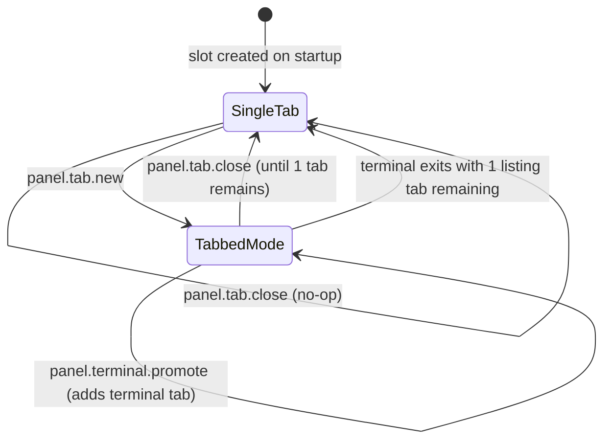
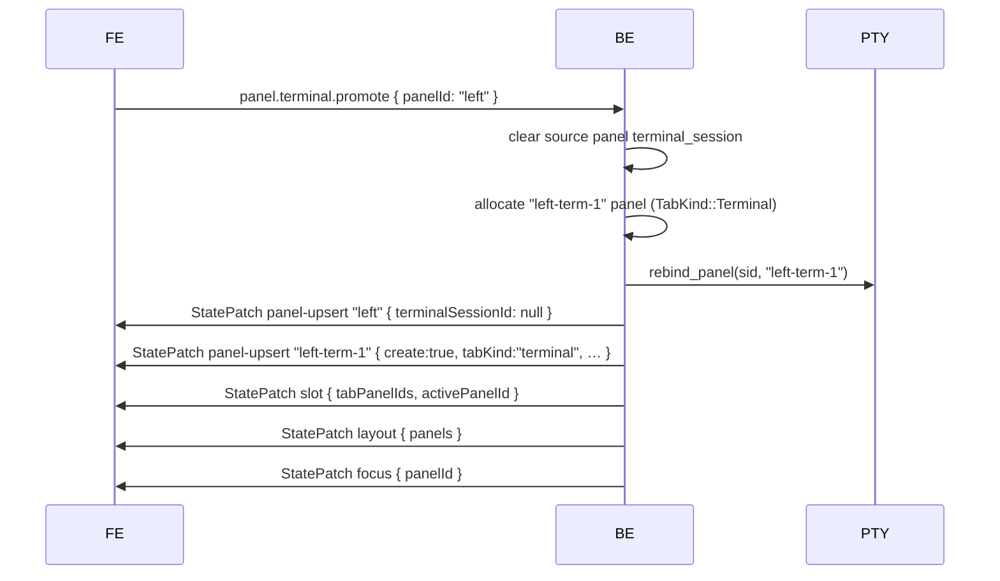
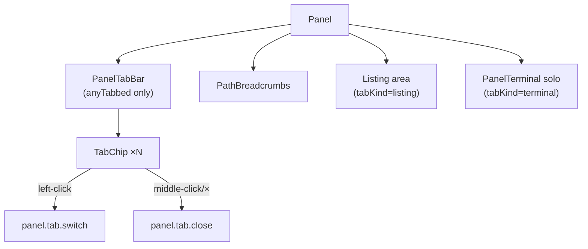

# Tabbed Panel Mode

Each layout slot can host multiple **tabs**. A tab is a full panel record — it preserves its own cursor position, selection, sort order, scroll offset, and view mode. Tabs are invisible while a slot has only one; the tab bar surfaces automatically once a second tab is opened ("implicit tabbed mode").

---

## 1. Concepts

| Term | Definition |
|---|---|
| **Slot** | A layout position (e.g. `"left"`, `"right"`). Groups one or more panels as tabs. |
| **Panel** | One tab inside a slot. Owns a full directory listing state or a live PTY session. |
| **TabKind** | `listing` (folder view, default) or `terminal` (promoted PTY). |
| **Active tab** | The panel currently visible in the slot. Only this panel receives keyboard events and renders its content. |
| **Implicit mode** | The tab bar is only rendered when `slot.tabPanelIds.length > 1`. Single-tab slots look identical to the pre-tabs UI. |

---

## 2. Data Model

### 2.1 Backend (`src-tauri/src/state/mod.rs`)

```rust
pub enum TabKind { Listing, Terminal }

pub struct PanelSlot {
    pub slot_id: String,
    pub tab_panel_ids: Vec<String>, // ordered, len >= 1
    pub active_panel_id: String,
}

// Added to Panel:
pub slot_id: String,
pub tab_kind: TabKind,
pub tab_title_override: Option<String>,
```

`AppState` carries:

```rust
pub slots: HashMap<String, PanelSlot>,
pub layout_slots: Vec<String>,   // ordered slot ids (drives visible layout)
```

`layout.panels` is kept as the parallel list of **active panel ids per slot** for back-compat; code that understands slots should read `layout_slots` and dereference via `slots[slotId].activePanelId`.

### 2.2 Frontend (`src/ws/types.ts`, `src/store/index.ts`)

```ts
interface PanelSlot {
  slotId: string;
  tabPanelIds: string[];
  activePanelId: string;
}

// PanelState (existing) gains:
slotId: string;
tabKind: "listing" | "terminal";
tabTitle?: string;

// AppState gains:
slots: Record<string, PanelSlot>;
layoutSlots: string[];
```

`focus` continues to address a **panel id** (the active tab's panel). All existing focus logic is unchanged.

Only active listing tabs contribute their actual viewport to thumbnail
generation priority. Creating, switching, closing, or promoting a tab refreshes
the pool's visibility set, so hidden tabs' work waits for the background cooldown.

---

## 3. Tab Lifecycle

### 3.1 State machine



### 3.2 New tab (`panel.tab.new`)

1. If the active panel is a local filesystem listing, clone its `source_id`, `path`, and backend symlink return context; otherwise use the local source containing the user's Home directory and start at Home.
2. Allocate a new panel id; insert it after the active tab in `tab_panel_ids`.
3. Set `active_panel_id` to the new panel id; update `focus`.
4. Emit targeted patches: `panel-upsert` (create:true), `slot`, `layout`, `focus`.

### 3.3 Switch tab (`panel.tab.switch`)

1. Set `slot.active_panel_id` to the requested panel id.
2. Update `AppState.focus` if the slot is focused.
3. Emit: `slot` patch + `layout` patch + `focus` patch. No full snapshot.

### 3.4 Close tab (`panel.tab.close`)

1. If the slot has only one tab → no-op.
2. Remove the panel id from `tab_panel_ids`; remove the `Panel` record.
3. Activate the tab to the left (or the new first tab if the closed tab was leftmost).
4. Emit: `slot` patch + `layout` patch + `focus` patch + `panel-remove` patch.

### 3.5 Terminal promotion (`panel.terminal.promote`)

1. Read `source_panel.terminal_session = Some(sid)`.
2. Clear `terminal_session` on the source panel → returns it to listing view.
3. Allocate a new panel id; build `Panel { tab_kind: Terminal, terminal_session: Some(sid), … }`.
4. Insert the new panel after the source in `tab_panel_ids`; activate it.
5. Call `pty_manager.rebind_panel(sid, new_panel_id)` so natural-exit cleanup targets the new tab.
6. Emit: `panel-upsert` (source, terminal_session cleared) + `panel-upsert` (new terminal tab, create:true) + `slot` + `layout` + `focus` patches.



---

## 4. Protocol

### 4.1 Intents (FE → BE)

| Intent | Payload | Description |
|---|---|---|
| `panel.tab.new` | `{ slotId, source: "clone" }` | New tab cloning active source + path. |
| `panel.tab.close` | `{ panelId }` | Close tab; no-op when it's the only tab. |
| `panel.tab.switch` | `{ slotId, panelId }` | Activate a tab. |
| `panel.tab.rename` | `{ panelId, title }` | Override tab title (protocol only, no UI yet). |
| `panel.terminal.promote` | `{ panelId }` | Promote embedded PTY to sibling tab. |

### 4.2 Patches (BE → FE)

All tab operations use **targeted patches** — no full `StateSnapshot` is emitted.

| Domain | Payload | When |
|---|---|---|
| `panels` | `{ create:true, slotId, tabKind, … }` | New tab created |
| `panels` | `{ remove:true }` | Tab closed |
| `panels` | `{ terminalSessionId: null }` | Source panel cleared on promote |
| `slots` | `{ tabPanelIds, activePanelId }` | Any tab membership/activation change |
| `layout` | `{ panels: […] }` | Whenever `layout.panels` (active-per-slot list) changes |
| `focus` | `{ panelId }` | Active panel changed |

---

## 5. Terminal Tabs

### 5.1 PTY ownership

The PTY session (`PtySession`) carries its owning panel id as `Arc<Mutex<String>>`. This shared reference lets the wait-for-exit thread always read the **current** owner, even if the session was promoted after spawn.

```
PtySession.panel_id: Arc<Mutex<String>>
                          ↑ shared with wait-for-exit thread
```

`rebind_panel(sid, new_panel_id)` writes through this `Arc` without restarting the process.

### 5.2 xterm.js buffer preservation

Switching away from a terminal tab unmounts the React component. To keep the buffer and scrollback alive the FE uses a **module-level cache** keyed by session id:

```ts
const TERM_CACHE = new Map<number, CachedTerm>();
// { terminal: Terminal, fitAddon: FitAddon, element: HTMLElement }
```

On unmount the DOM element is detached but the `Terminal` instance is kept. On remount the same instance is reattached and `fitAddon.fit()` is called. The cache entry is removed only when `TerminalClosed` arrives.

### 5.3 Auto-close on shell exit

When the shell exits naturally (user typed `exit` or the process died):

1. The wait-for-exit thread checks `tab_kind == Terminal`.
2. If the slot has more than one tab → remove the terminal tab and activate the left neighbor (same logic as `panel.tab.close`).
3. If it's the only tab → clear `terminal_session` and keep the panel (it reverts to an empty listing).
4. Emit `TerminalClosed` + the appropriate `slot` / `layout` / `focus` patches.

---

## 6. Keybindings

These bindings are **panel-scoped**: they fire only when a panel listing has focus.

| Command | Default binding | Behavior |
|---|---|---|
| `panel.tab.new` | Ctrl/Cmd+T | New tab (clone active local listing; otherwise open Home) |
| `panel.tab.close` | Ctrl/Cmd+W | Close active tab; no-op on last tab |
| `panel.tab.next` | Shift+K | Activate next tab (wraps) |
| `panel.tab.prev` | Shift+J | Activate previous tab (wraps) |

Middle-click on a tab chip also closes it. Double-clicking on **empty space** in the tab bar uses the same New Tab behavior as Ctrl/Cmd+T: clone the active local filesystem listing, or open Home when the active tab is virtual, remote, or terminal.

---

## 7. UI Rendering

### 7.1 Tab bar alignment rule

The tab bar (`PanelTabBar`) is rendered in **all** panels when **any** slot has more than one tab. This prevents vertical misalignment when one panel enters tabbed mode while the other remains single-tab.

```tsx
const anyTabbed = Object.values(appState.slots).some(s => s.tabPanelIds.length > 1);
// PanelTabBar rendered above PathBreadcrumbs only when anyTabbed === true
```

### 7.2 Terminal tab layout

A terminal tab fills the full panel area. The `panel-terminal--solo` CSS modifier is applied when `tabKind === "terminal"` to override the 50 % height used in embedded split-view mode.

### 7.3 Component hierarchy



---

## 8. Persistence

### 8.1 Session schema

Slots and their tabs are serialized to `session.toml` under a `[[slots]]` block:

```toml
[[slots]]
slot_id = "left"
active_index = 0

  [[slots.tabs]]
  kind = "listing"
  source_id = "home"
  rel_path = "projects/fbro"
  sort_field = "name"
  sort_asc = true
  view_mode = "grid"
  cursor = "src"
  scroll = 0

  [[slots.tabs]]
  kind = "listing"
  source_id = "home"
  rel_path = "projects/fbro/src"
  # ...
```

**Terminal tabs are not persisted.** They are silently dropped at save time. `active_index` is computed over the surviving listing tabs only; if the active tab was a terminal, it falls back to index 0.

### 8.2 Back-compat

Session files written before tabs were introduced contain a flat `[panels.left]` / `[panels.right]` map. The loader detects the absence of `[[slots]]` blocks and synthesises one single-tab slot per panel entry, preserving identical behavior on upgrade.

### 8.3 Setting

`persist_panel_tabs: bool` (default `true`) in `GeneralSettings`. When `false`, only the active tab per slot is written — identical to pre-tabs behavior. Exposed in the General settings panel as "Restore all panel tabs across sessions".

---

## 9. Back-compat Summary

| Scenario | Behavior |
|---|---|
| Old session file (no `[[slots]]`) | Each `[panels.*]` entry becomes a single-tab slot — UI unchanged |
| `persist_panel_tabs = false` | One tab per slot saved; restores identically to today |
| Single-tab slot | Tab bar hidden; all keyboard/mouse behavior unchanged |
| Source `sourceId` missing on restore | Tab opens at home path; warning toast shown |
