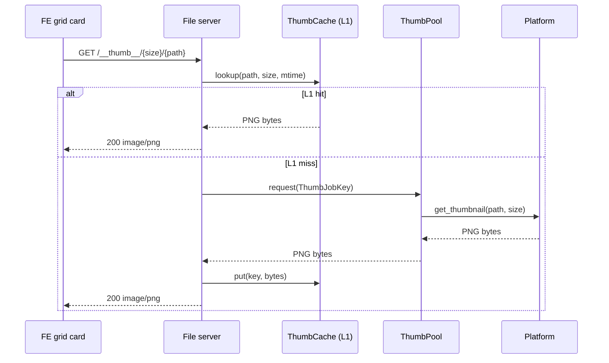

# fbro — Thumbnail System

Thumbnails are visible when a panel is in **grid view** (Shift+G). This
document covers how thumbnails are generated, cached, prioritised, and
delivered to the FE, plus the build-time requirements for the Linux
implementation.

---

## 1. Overview



The FE never calls the BE WebSocket to request thumbnail bytes. Each grid card
uses the native `IntersectionObserver` to fetch from the local HTTP file server
(`http://127.0.0.1:{fileServerPort}/__thumb__/{size}/{path}`) only while it
intersects the viewport. Leaving the viewport aborts the fetch, freeing the
browser connection for newly visible cards. Received PNG blobs are rendered
through object URLs, revoked when the card leaves view or unmounts. Aborts do
not mark a thumbnail as failed; re-entering the viewport fetches it again.

---

## 2. Panel grid mode and `supportsThumbnails`

Grid mode is gated by the `supportsThumbnails` flag on the panel state:

```ts
// Panel.tsx
const isGridMode = panel.viewMode === "grid" && panel.supportsThumbnails;
```

The BE sets this flag per panel based on the VFS driver that backs it:

```rust
// vfs/local.rs
fn supports_thumbnails(&self) -> bool { true }
```

Only `LocalFsDriver` (real host paths) returns `true`. Archive shadow sources,
search result panels that mix paths across sources, and any virtual panel
that does not expose host-filesystem paths return `false`. This is important
because the thumbnailer needs a real host path — it cannot thumbnail entries
inside a zip file or a remote VFS.

When `supportsThumbnails` is `false`, Shift+G is a no-op and the grid toggle
command is ignored.

---

## 3. Thumbnail URL structure

```
http://127.0.0.1:{fileServerPort}/__thumb__/{size}/{percent-encoded-host-path}?panelId={panelId}&panelEpoch={panelEpoch}
```

| Segment | Details |
|---------|---------|
| `fileServerPort` | Ephemeral localhost port chosen at startup; sent to FE in the `Welcome` message |
| `size` | Requested longer-edge size in pixels; clamped to 32–512 by the file server |
| `panelId`, `panelEpoch` | Required listing scope; obsolete or missing scopes return `204` without generation |
| `percent-encoded-host-path` | Absolute host filesystem path, percent-encoded (same encoding as `encodeURIComponent`) |

The size in the URL is the card width in pixels. The FE reads this from
`gridMetrics.cardWidth`, which is measured from the DOM after each resize.

Expanded grid cards reflect the entry's current backend selection state,
including changes while expanded. Their selection fill is composited over an
opaque tooltip surface and persists under hover in both colour schemes.

---

## 4. File server (`fileserver.rs`)

The file server is a minimal hand-written HTTP/1.1 server (no async framework)
running on its own OS thread. It handles three route prefixes:

| Prefix | Purpose |
|--------|---------|
| `/__thumb__/{size}/{path}` | Thumbnail delivery |
| `/__icon__/{name}` | Panel entry icons |
| `/{abs-path}` | Raw file streaming for the viewer (supports `Range:`) |

For thumbnail requests, the server:

1. Validates the active panel and listing epoch, then parses `size` and the percent-decoded path.
2. Reads `mtime` from the filesystem (used as a cache-busting key).
3. Checks the **L1 in-memory cache** (`ThumbCache`). On hit: respond immediately.
4. On miss: submits a `ThumbJobKey { path, size, mtime }` to the `ThumbPool`
   and blocks the handler thread waiting for the result.
5. On success: inserts into L1 and responds `200 image/png`.
6. On failure (platform returned nothing): responds `404`.

Multiple concurrent requests for the same `(path, size, mtime)` within the
same panel location lifetime and request priority/policy are deduplicated inside the pool — only one generation job runs; all waiters
receive the same result.

---

## 5. L1 cache — `ThumbCache`

An in-memory LRU cache capped at **1024 entries** (≈ 20 MB at ~20 KB/PNG).
Implemented as a `HashMap<(path, size, mtime), (bytes, last_used_seq)>` behind
a `Mutex`. On eviction, the entry with the smallest `last_used_seq` is
removed.

The cache is held in an `Arc<ThumbCache>` shared between the file server and
`AppState`. This allows the `ClearThumbnailCache` intent handler to call
`thumb_cache.clear()` and invalidate L1 without restarting the server.

---

## 6. ThumbPool — visibility-driven prioritisation

`ThumbPool` (`thumb_pool.rs`) manages a fixed worker pool (default: **8
threads**). Each worker calls `Platform::get_thumbnail_cancellable()` to produce PNG bytes.

### 6.1 Two-queue priority

Jobs are held in a **high queue** (currently-visible cards) and a **low queue**
(off-screen cards). Workers always drain the high queue first.

When a job is dequeued, the worker re-checks visibility: if the card has
scrolled off-screen in the meantime, the job is demoted to the low queue. This
ensures that after a fast scroll the visible cards always have priority.

Off-screen work waits for a **12-second cooldown** after the visibility set
changes, a visible/foreground request is enqueued, or visible/foreground work
finishes. Repeated reports of the same viewport do not restart the cooldown.
Workers sleep on a timed condition variable and wake immediately for newly
visible work; background generation resumes automatically at the deadline.
Platform thumbnail calls already running may finish, but no new off-screen
work starts during the cooldown.

Explicit inline previews mark their HTTP request `?foreground=1` and bypass
the cooldown, even in list mode. Speculative `?prefetch=1` warmups cannot use
this bypass. Preview requests and grid requests have distinct pool keys so
foreground previews cannot wait behind an off-screen grid request.

### 6.2 Visibility signal

The BE tracks which paths are currently in any grid panel's visible window. On
every scan, window-slice update, or cursor move the runtime calls:

```rust
let paths = crate::state::collect_visible_thumb_paths(&state);
state.thumb_pool.set_visible(paths);
```

The frontend supplies `panelEpoch`, `visibleStart`, and `visibleCount` with
grid `RequestWindow` intents, independently of the buffered render range.
The backend resolves those indices against its listing; stale epochs are
ignored. This also works in small, non-windowed directories. Until a viewport
is reported for the current epoch, entries count as background work.

`collect_visible_thumb_paths` considers only active listing tabs in visible
layout slots, excluding terminal surfaces, and only their reported viewport.
It includes files and file symlinks. Buffered cards, inactive tabs, and old
listing epochs never count as visible. Tab changes refresh priority immediately.

### 6.3 Location lifetime and cancellation

The backend scopes local thumbnail work to each active listing panel's source
and location. Navigation, source replacement/removal, tab hiding/closing, or
switching to a terminal discards that panel's queued work immediately, releases
HTTP waiters, and signals cancellation to its active workers. Late HTTP requests
with the old panel epoch cannot refill the abandoned queue. Returning to the
same location creates a fresh lifetime, so an old completion cannot consume
new work. A rescan of the same source/location updates admission epochs while
preserving already admitted work. Other displayed panels keep their work.

Linux checks cancellation at image reads/seeks, decode/resize boundaries, and
video packets/frames. Cancelled generation does not write a decode-failure
sentinel. A decoder operation already executing can finish before its next
checkpoint. macOS and Windows check before and after the native thumbnail call;
an OS call already in progress must return before its worker can stop. Active
cancelled workers are reported as `Cancelling` until they return; queued counts
clear immediately. L1/L2 cache entries remain reusable across locations.

### 6.4 Concurrency cap

When an embedded viewer is open the pool's `max_concurrent` is dialled down
(via `set_max_concurrent`) so thumbnail workers yield CPU to the viewer's
decode work.

### 6.5 Queue inspection

On platforms with `settings.general.supportsManagedThumbnails` (Linux), the
Jobs modal includes a **Thumbnails** tab showing running and queued
counts, the current concurrency limit, and up to the first 100 tasks in
dispatch order (running first). Rows show the host path, requested pixel size,
visibility priority, and whether the task is a speculative warmup. Duplicate
requests within one location lifetime count as one task. Empty pools show “No thumbnail work queued.”
While background work waits, the summary shows its remaining cooldown.

The backend returns an atomic, read-only pool snapshot through
`QueryThumbnailQueue` / `ThumbnailQueueReady` (see [Protocol](proto.md)). The
frontend refreshes it once per second only while the tab is selected. This
query works with all platform thumbnail providers, but the UI hides the tab for
native macOS/Windows providers. Arrow/Home/End navigation uses the visible tabs.
Closing the modal leaves work
running; the view adds no cancellation or reordering controls.

---

## 7. Platform abstraction

`Platform::get_thumbnail` is a trait method with a default no-op
implementation. Each platform overrides it:

| Platform | Implementation |
|----------|---------------|
| Linux | `platform/linux/thumbnail.rs` — custom generator (image + video) |
| macOS | `QLThumbnailGenerator` via AppKit/QuickLook |
| Windows | `IShellItemImageFactory` via Win32 COM |

On macOS and Windows the OS thumbnail provider handles all format support
automatically.

---

## 8. Linux thumbnailer (`platform/linux/thumbnail.rs`)

freedesktop DBus thumbnailers (Tumbler, etc.) are not always installed — for
example, PopOS Cosmic ships none by default. fbro therefore generates
thumbnails itself for a curated set of formats rather than depending on an
external service.

### 8.1 Supported formats

| Kind | Extensions |
|------|-----------|
| Image | `png jpg jpeg webp gif bmp tif tiff` |
| Video | `mp4 mkv webm mov avi m4v` (requires `linux-video` feature) |

Files with any other extension return no thumbnail (the FE falls back to the
icon).

### 8.2 Two-level cache

| Level | Location | Key | Invalidation |
|-------|----------|-----|-------------|
| L1 | In-memory `ThumbCache` | `(path, size, mtime_secs)` | LRU eviction or explicit clear |
| L2 | `$XDG_CACHE_HOME/fbro/thumbnails/` (or `~/.cache/fbro/thumbnails/`) | `blake3(canonical_path ‖ mtime_ns ‖ size).hex + .png` | `mtime` change or explicit clear |

On a cache hit at L2 the PNG bytes are returned directly without decoding the
source file. A failed-generation sentinel (`.fail` file alongside the `.png`)
is honoured for **24 hours** to avoid repeatedly retrying genuinely-broken
files; after 24 hours the sentinel is removed and generation is retried.

Writes to L2 are **atomic**: content is written to a unique `{key}.{uuid}.tmp` then
renamed over `{key}.png`, so a crash mid-write leaves a stale `.tmp` but the
last good thumbnail intact.

### 8.3 Image thumbnailing

Uses the `image` crate. Files larger than `thumbnail_max_image_size_mb` (user
configurable, default 100 MiB) are skipped to avoid memory blowup on raw /
multi-gigapixel images.

### 8.4 Video thumbnailing (`linux-video` feature)

Uses `ffmpeg-next` (Rust bindings to libav). The generator:

1. Opens the file's best video stream with `ffmpeg::format::input`.
2. Decodes frames sequentially, discarding the first
   `thumbnail_video_frame_skip` frames (default: 5) to avoid black or
   studio-card intros.
3. Scales the chosen frame to fit within `size × size` using the `BILINEAR`
   algorithm via `ffmpeg::software::scaling`.
4. Encodes the result as PNG via the `image` crate and writes to L2.

### 8.5 Cache-directory self-reference guard

If the path being thumbnailed is itself inside the L2 cache directory (e.g.
the user navigated to `~/.cache/fbro/thumbnails/`), the file is returned
directly without re-thumbnailing. This prevents recursive thumbnail generation
and avoids writing new cache entries for files that are already thumbnails.

### 8.6 Runtime-tunable settings

Three atomic values control thumbnailer behaviour at runtime without a restart:

| Atomic | Type | Default | Setting key |
|--------|------|---------|-------------|
| `ENABLE_VIDEO_THUMBNAILS` | `AtomicBool` | `true` | `enableVideoThumbnails` |
| `MAX_IMAGE_BYTES` | `AtomicU64` | 100 MiB | `thumbnailMaxImageSizeMb` |
| `VIDEO_FRAME_SKIP` | `AtomicU32` | 5 | `thumbnailVideoFrameSkip` |

All three are exposed in **Settings → Display**. Changes take effect
immediately for new thumbnail requests (in-flight jobs use the value they read
at the start of generation).

---

## 9. Settings → Display tab

The Display tab (`SettingsDisplayTab.tsx`) exposes the Linux thumbnailer knobs
and cache management, gated by the backend's `supportsManagedThumbnails`
capability. On macOS/Windows it hides those controls and shows an informational
note about native providers. The thumbnail streaming toggle remains on all platforms.

| Control | Setting key | Intent |
|---------|-------------|--------|
| Enable video thumbnails | `enableVideoThumbnails` | `SetGeneralOption` |
| Skip images larger than N MiB | `thumbnailMaxImageSizeMb` | `SetGeneralOption` |
| Skip first N video frames | `thumbnailVideoFrameSkip` | `SetGeneralOption` |
| Clear thumbnail cache | — | `ClearThumbnailCache` |

The **Clear cache** button shows the current L2 cache size (item count and
total bytes of `.png` files) and is disabled when the cache is empty. After
clearing, the BE broadcasts a `StatePatch` with zeroed stats so the UI updates
without a round-trip.

Cache stats (`thumbnailCacheItemCount`, `thumbnailCacheSizeBytes`) and the
cache directory path (`thumbnailCacheDir`) are read-only fields included in
the `settings.general` snapshot. Because the `SetGeneralOption` patch only
carries mutable settings fields, the FE reducer **merges** incoming patches
into the existing `general` object rather than replacing it, preserving
derived fields across settings changes.

---

## 10. Building on Linux

### 10.1 Image-only build (no video)

The image thumbnailer requires no additional system packages beyond the Tauri
prerequisites. Add the following to `Cargo.toml` to enable image thumbnailing:

```toml
[target.'cfg(target_os = "linux")'.dependencies]
image  = { version = "0.25", default-features = false,
           features = ["png", "jpeg", "webp", "gif", "bmp", "tiff"] }
blake3 = "1"
```

Disable the default `linux-video` feature to build without ffmpeg:

```sh
cargo build --no-default-features
```

### 10.2 Video build (default)

Video thumbnailing requires `ffmpeg-next` (Rust bindings) plus the
corresponding system libraries. Install the build dependencies:

```sh
# Debian / Ubuntu / PopOS
sudo apt install \
  libavcodec-dev libavformat-dev libavutil-dev \
  libswscale-dev libavfilter-dev \
  pkg-config clang llvm-dev ffmpeg

# Fedora / RHEL
sudo dnf install \
  ffmpeg-devel clang llvm-devel pkg-config

# Arch
sudo pacman -S ffmpeg clang llvm pkgconf
```

Then build normally (the `linux-video` feature is on by default):

```sh
cargo build
# or
cargo tauri dev
```

`clang` and `llvm-dev` are required because `ffmpeg-next`'s build script
uses `bindgen` to generate FFI bindings from the system libav headers.

### 10.3 Feature flag summary

| Feature | Default | Effect |
|---------|---------|--------|
| `linux-video` | ✓ on | Compiles `generate_video()` and links `ffmpeg-next` |
| *(none)* | — off | Image-only build; video files produce no thumbnail |

The `linux-video` feature is declared in `src-tauri/Cargo.toml`:

```toml
[features]
default = ["linux-video"]
linux-video = ["ffmpeg-next"]
```

---

## 11. Key files

| File | Role |
|------|------|
| `src-tauri/src/platform/linux/thumbnail.rs` | Linux thumbnailer: classify, L2 cache, image decode, video decode |
| `src-tauri/src/thumb_pool.rs` | Worker pool: two-queue priority, visibility, concurrency cap |
| `src-tauri/src/fileserver.rs` | HTTP server: `/__thumb__/` route, L1 `ThumbCache` |
| `src-tauri/src/state/mod.rs` | `AppState` holds `Arc<ThumbPool>` and `Arc<ThumbCache>` |
| `src-tauri/src/ws/runtime.rs` | `collect_visible_thumb_paths`, snapshot/patch helpers |
| `src-tauri/src/ws/intents/settings.rs` | `SetGeneralOption` (knob changes), `ClearThumbnailCache` |
| `src-tauri/src/state/settings.rs` | `GeneralSettings` — three thumb fields with serde defaults |
| `src-tauri/src/ws/protocol.rs` | `GeneralSettingsSchema` — snapshot wire type |
| `src-tauri/src/vfs/local.rs` | `supports_thumbnails() → true` for local FS |
| `src/components/EntryThumb.tsx` | FE: intersection-gated, abortable thumbnail fetches and object URLs |
| `src/components/Panel.tsx` | FE: grid layout, `isGridMode` guard, visibility reporting |
| `src/components/SettingsDisplayTab.tsx` | FE: Display tab UI |
